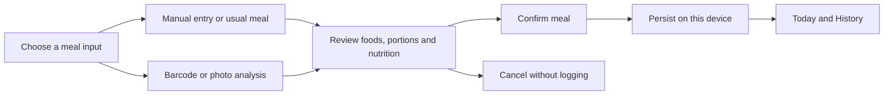
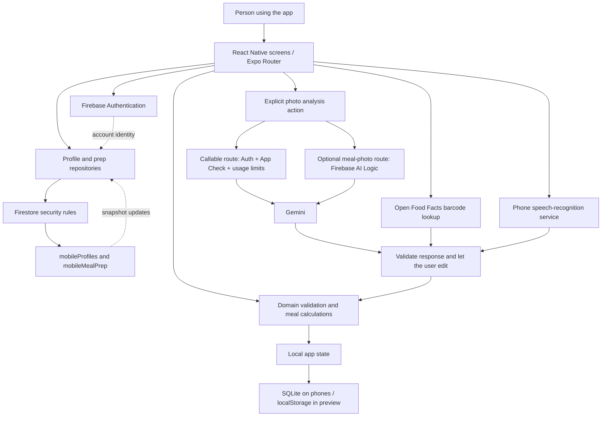

# 360fitness

**Plan meals you enjoy, record what you actually ate, and build a routine that fits your day.**

360 Fitness is an iPhone and Android app built with React Native and Expo. It combines onboarding, meal planning, meal prep, manual food logging, product scanning and reviewable AI food estimates. A separate React website provides a companion experience.

**Release status — October 10, 2026:** this is a working development foundation. Some features work locally; cloud and AI features depend on the installed build's configuration. This document describes the checked-in implementation, not a claim that every service is deployed or that the app is available in stores.

## Contents

- [For app users](#for-app-users)
- [Your main journeys](#your-main-journeys)
- [Feature availability](#feature-availability)
- [System architecture](#system-architecture)
- [How information moves](#how-information-moves)
- [Where your data lives](#where-your-data-lives)
- [Accounts and multiple users](#accounts-and-multiple-users)
- [Offline behavior and recovery](#offline-behavior-and-recovery)
- [Frontend, backend and database responsibilities](#frontend-backend-and-database-responsibilities)
- [Repository structure](#repository-structure)
- [Run the project](#run-the-project)
- [Testing and delivery](#testing-and-delivery)
- [Roadmap and contribution](#roadmap-and-contribution)
- [Further reading](#further-reading)

## For app users

| Screen | What you use it for | What to expect |
| --- | --- | --- |
| **Today** | Check in on meals and start adding food | Confirm what you ate, adjust portions or skip a meal. Planning a meal does not automatically record it as eaten. |
| **My Plan** | Organize your usual meals and access meal prep | Edit reusable meals and plan batches. Changing a template does not rewrite previous food logs. |
| **History** | Review intake and nutrition trends | Recorded meals and calorie/protein charts, including 7/30-day views. Missing records are not treated as zero intake. |
| **Profile** | Review preferences, account options and app information | Update answers and access optional cloud profile controls. A preferred check-in time does not currently schedule a reminder. |

The design direction is a compact main screen with details opened when needed. Reported scrolling, meal visibility, dictation and gesture improvements remain in the [feedback backlog](docs/USER-FEEDBACK-BACKLOG.md).

For phone testing, ask the project owner for an installable preview build. Native speech and attestation features require a compatible signed build; opening the browser preview or Expo Go does not prove those features work on a phone. See [tester access and app accounts](docs/expo-and-app-users.md).

## Your main journeys

### 1. Build your routine

1. Open the welcome screen and start onboarding.
2. Answer profile, goal, lifestyle, food, exercise and tracking questions. Skip optional fields if desired.
3. Enter your preferred check-in time using the 12-hour controls.
4. Review your answers and finish setup. The completed profile is stored on this device.
5. For a cloud copy, open Account, sign in or register, verify your email, review the save action and confirm it.

Onboarding drafts can be resumed. Preferences are inputs for personalization; collecting an answer does not mean every associated recommendation, reminder or integration is implemented.

### 2. Record a meal

Choose manual entry, a usual meal, a product scan or an available photo-analysis option. Review food names, portions, units and nutrition, then explicitly confirm the meal. The app saves a dated food snapshot and derives history from confirmed entries.

Unknown nutrition stays unknown. AI estimates and sample meals are inputs for review, not verified measurements. Editing a saved entry keeps its original date; editing a reusable meal affects future use of that template.



### 3. Prepare meals ahead

Choose a starter recipe, enter your own recipe or request an AI recipe when configured. Review ingredients and servings, add it to a prep plan, use the combined grocery quantities and follow the preparation steps. Marking a batch as prepared does not log it as eaten; record the portion separately when you eat it.

The current grocery list calculates quantities. It is not a live-price comparison, purchasing or delivery service. An optional cloud prep-plan copy uses a separate review/save flow.

### 4. Use your voice

Supported text fields offer speech-to-text with transcript review. Start recording, stop, review the words and choose whether to apply them. Typing remains available if speech is unavailable or permission is denied.

Voice entry currently fills a field. A daily AI conversation that asks follow-up questions and confirms a whole-day record is planned. The phone's speech service may process audio online; the app does not intentionally save raw recordings in its meal/profile records.

## Feature availability

“Implemented” means code exists for the flow. Live configuration and physical-device acceptance remain separate checks.

| Capability | Current implementation | Remaining boundary |
| --- | --- | --- |
| Onboarding | Local drafts, validation, review/edit and 12-hour time entry | Requested measurement changes and downstream personalization |
| Manual meals | Local persistence, portions, confirmation, skip and editing | Reported missing-log/Today-display bugs need device reproduction and fixes |
| Meal prep | Starter recipes, batch servings, preparation steps and grocery quantities | Budget-aware recommendations, pricing and personalized full-week planning |
| Product barcode | Open Food Facts lookup and editable import | Dataset coverage varies; package details still need checking |
| Label photos | Selection, callable analysis adapter and review | Configured functions, native App Check and device validation |
| Meal photos | Callable route or optional Firebase AI Logic route | Provider enablement, model availability, production protection and quality evaluation |
| Voice input | OS speech integration and transcript review | Signed-build behavior and keyboard issue; full AI conversation pending |
| Accounts/cloud copies | Email/password UI; profile and prep save/restore repositories | Full diary sync, local account isolation and cloud release checks |
| Notifications | Frequency/time preferences collected | Permissions, tokens, scheduling, delivery and deep links |
| Wider fitness features | Product requirements and some preference fields | Workouts, sleep, hydration, caffeine, wearable sync and approved AI memory |

## System architecture

The mobile app has three main internal layers: screens, domain rules that validate actions, and storage/service adapters. Firebase provides identity, selected cloud records and backend endpoints. AI responses pass through validation and review before becoming meal data.

This diagram shows implemented code paths. Availability depends on build configuration; it does not imply every service is live.



The companion website has its own React components and state implementation. It is not the phone app's server, and its browser data is not automatically shared with the native app. Historical Flutter code is retained for reference and is not part of the React Native runtime.

## How information moves

### Profile and prep cloud copies

Firebase Authentication provides a user ID, or **UID**. A UID identifies an account; Firestore rules decide which records it may access.

Profile and prep saves use transactions. Each cloud record has a revision and generation ID. If another device changes the record after the review opened, saving fails with a conflict instead of silently overwriting the newer version. Snapshot listeners expose remote changes, but local answers are not silently replaced. Saving and restoring are explicit actions. Offline transaction failures remain visible for retry.

### Photos and AI

1. The user chooses or captures a photo and explicitly starts analysis.
2. The app prepares the image and sends it through the selected configured route.
3. The response is parsed against the expected food/nutrition structure. Invalid or unclear results produce a message rather than a fabricated meal.
4. The user edits the suggested foods and portions, then chooses whether to log them.

| Route | Current use | Protection and configuration |
| --- | --- | --- |
| **Firebase callable functions** | Label photos, meal photos and recipe analysis; a text parsing endpoint also exists | Request authentication, native App Check and server usage checks. Gemini credentials belong in server secret configuration. The mobile automatic text-parser flow is not fully connected. |
| **Firebase AI Logic** | Optional meal-photo analysis selected by a build flag | Uses Firebase's AI proxy instead of these application callables. It does **not** use this repository's `analysisUsage` quota code. Its App Check/rate-limit configuration needs separate release verification. |

Neither route requires embedding a Gemini provider secret in the mobile app. Firebase AI Logic's proxy keeps that key server-side; see [its official architecture](https://firebase.google.com/docs/ai-logic). Public Firebase client identifiers are configuration, not permission to read another user's records.

Photo requests need network access. The saved meal/profile model does not archive raw photos or audio, and this flow has no implemented Cloud Storage media archive. Temporary device files and provider processing/retention are separate from saved app records and require a documented release policy.

### Barcode lookup

The app sends a product barcode to Open Food Facts and shows available nutrition, ingredients and reported allergens. Missing fields stay missing. A product match is not a personal health verdict, and absent allergen data must not be treated as a safety guarantee.

## Where your data lives

| Data | Current location | Behavior |
| --- | --- | --- |
| Onboarding draft and completed profile | Phone SQLite; browser preview localStorage | One versioned local record; profile cloud copy is optional |
| Usual meals and dated meal entries | Same local record | Survive restart after saving; no automatic cloud diary backup |
| Meal prep plan | Local state; optional `mobileMealPrep/{uid}` copy | Review/save/restore with conflict checks |
| Cloud profile | `mobileProfiles/{uid}` | Verified-owner access and schema validation |
| Callable AI usage counters | `analysisUsage/{uid}` | Backend-owned limits; not client-editable |
| Login session | Firebase Auth persistence | Separate from meal/profile storage; app code does not store your password |
| Unsaved meal editor | Screen state | Do not assume unsaved edits/imported estimates survive restart |

The current local schema is deliberately small:

```text
AppState (version 1)
  onboarding + goal
  profileDraft? + profile?
  templates[]                   reusable usual meals
  entries[]                     confirmed or skipped meals by local date
    id + date + status + updatedAt
    foods[]                     snapshot of food and portion values
      quantity + unit + source
      kcal / protein / carbs / fat (number or unknown)
  mealPrep?                     planned batches and preparation state
```

Fiber is not currently in the core nutrient model. A skipped meal and an unknown nutrient are different from a measured zero. Cloud profiles contain a validated profile object; cloud prep records contain a bounded serialized plan payload. These are whole-record copies, not a normalized cloud meal diary.

### Planned database evolution

The following is a proposal, **not deployed collection definitions**:

```text
Local storage, separated by guest ID or Firebase UID
  profile / drafts / meal events / prep plans
  pending operations with stable IDs and retry state

mobileUsers/{uid}/
  preferences/current
  events/{eventId}               meals and future tracking events
  days/{localDate}               derived summaries
  checkInSessions/{sessionId}    reviewable daily drafts
  devices/{deviceId}             consented notification registrations
  memories/{memoryId}            explicitly approved AI memories
```

Before adopting it, implement versioned migrations, owner-only rules, idempotent writes, conflict handling, retention and complete account deletion. Existing profile/prep copies need a migration strategy. New records should not inherit the legacy `/users` wildcard rules without review.

## Accounts and multiple users

| Person | Access they need |
| --- | --- |
| App customer | Their own Firebase account for supported cloud features; local demo works without registration |
| Phone tester | A compatible installable test build; a separate app account for cloud testing |
| Developer | GitHub access for source work; Expo Organization membership for shared EAS access |

**Current limitation:** local state is one workspace per installation, not one per signed-in account. Signing out retains local data. Signing in as B does not automatically hide or separate A's local meals. UID-scoped storage and guest-import consent are release requirements before shared-device testing with personal data.

Deleting a cloud profile is different from deleting an entire account. A backend account-deletion endpoint exists, but the complete mobile reauthentication/deletion journey needs implementation and verification. See [account architecture](docs/mobile-architecture.md) and [tester/user setup](docs/expo-and-app-users.md).

## Offline behavior and recovery

| Situation | Expected current behavior |
| --- | --- |
| No internet | Existing local data remains available; manual editing uses local persistence |
| AI/barcode service unavailable | Explain the failure and offer manual entry; no invented success |
| Cloud save attempted offline | Fail visibly; preserve the local record for explicit retry |
| Another device updates a cloud copy | Expose the new cloud state; require review before local replacement |
| Analysis/dictation cancelled | Do not apply a late result to the saved record |
| App closes before saving a meal editor | Unsaved edits may be lost; saved state restores on reopening |
| App removed or storage cleared | Local meals may be lost; a cloud profile copy is not a full diary backup |

A durable automatic sync queue is planned. An unsent change must not be described as synchronized.

## Frontend, backend and database responsibilities

| Layer | Technology / code | Responsibility |
| --- | --- | --- |
| Mobile interface | React Native, Expo SDK 57, TypeScript, Expo Router | Screens, navigation, permissions, input and review |
| Domain rules | `apps/mobile/src/domain` | Profiles, portions, dates, validation and AI-result interpretation |
| Local state | `apps/mobile/src/data` | Serialize writes and restore saved state with platform adapters |
| Service adapters | `apps/mobile/src/services` | Firebase repositories, barcode, speech and AI transport |
| Identity | Firebase Authentication | Registration, sessions, verification and password reset |
| Cloud database | Firestore + `firestore.rules` | Owner access, supported schemas and versioned cloud copies |
| Backend | Node.js Firebase Functions | Callable validation, analysis, usage controls and deletion |
| AI | Gemini through callables or Firebase AI Logic | Candidate structured results for validation and review |
| Companion web | React, TypeScript, Vite | Separate browser application; Hosting/Vercel build target |
| Delivery | GitHub Actions + EAS configuration | Validate code; signed phone builds are a separate release step |

## Repository structure

```text
apps/
  mobile/
    src/app/                    screens and tab routes
    src/components/             forms, sheets and review UI
    src/domain/                 validation and product rules
    src/data/                   local state and storage adapters
    src/services/cloud/         Firebase Auth and repositories
    src/services/               photo, barcode and speech adapters
    tests/                      domain and repository tests
    app.config.ts + app.json    native configuration and permissions
    eas.json                    development / preview / production profiles
  web/                          companion React website
functions/
  index.js                      exported cloud functions
  src/                          validation, providers and access policies
  test/                         backend and Firestore rule tests
scripts/profile-rules.ts        generates/checks mobile profile rules
firestore.rules                 database authorization boundary
.github/workflows/              mobile, website and backend validation
docs/                          architecture, setup, research and backlog
lib/ + test/ + legacy/          historical Flutter/prototype code
```

## Run the project

### Mobile browser preview

Use Node.js 22 and npm. From the repository root:

```sh
cd apps/mobile
npm ci
npm run web
```

Use the URL printed by Expo. This previews React Native screens with browser-specific storage and capability limits.

For a compatible installed development client, run `npm start` in that directory and open its project link. For installable previews, follow the [phone build guide](apps/mobile/PHONE-BUILDS.md) and [current tester guide](docs/expo-and-app-users.md). An APK/IPA and a JavaScript export are different artifacts. See Expo's [internal distribution instructions](https://docs.expo.dev/build/internal-distribution/).

### Firebase and AI configuration

Copy `apps/mobile/.env.example` to ignored `apps/mobile/.env.local` and fill in the intended Firebase project's public client configuration. The checked-in `.firebaserc` selects a project; verify the target before deploying. Keep development and production environments separate.

Enable the required Auth providers and Firestore rules. Callable analysis additionally needs matching native Firebase configuration, App Check, deployed functions and server-side Gemini credentials. The optional meal-photo AI Logic route has its own Firebase Console setup and feature flag. Enabling one route does not configure the other.

Never put Gemini secrets, service-account private keys or signing credentials in `EXPO_PUBLIC_*` variables: these are included in client builds. See [label setup](docs/label-photo-ai-setup.md), [meal-photo analysis](docs/meal-photo-recognition.md) and [meal prep](docs/meal-prep.md).

### Companion website

Install the mobile dependencies too: the website imports shared meal-domain modules whose TypeScript configuration extends Expo's configuration.

```sh
npm --prefix apps/mobile ci
cd apps/web
npm ci
npm run dev
```

Open `http://localhost:5173`. Root Firebase Hosting and Vercel configuration target `apps/web/dist`. Starting the website does not start or deploy the native app's backend.

## Testing and delivery

From the repository root, after installing the relevant dependencies:

```sh
npm --prefix apps/mobile run check
npm --prefix apps/mobile run rules:check
# Run inside apps/mobile: npx expo export --platform all
npm --prefix apps/web run check
npm --prefix functions test
# Requires Java 21+:
npm --prefix functions run test:profiles
```

Local validation on October 10 passed 90 mobile tests, 66 backend tests, 8 website tests, mobile typecheck/lint, the website build, rule-generation checks and iOS/Android/web exports. The local Firestore emulator run could not start with Java 17. These are historical results, not a continuously updated CI badge or live-device acceptance evidence.

GitHub Actions validates code. Publishing a commit does not deploy Firebase or submit an app to a store. Release gates include CI, physical-device acceptance, user-data isolation, production service protection and reviewed privacy/deletion behavior. See [GitHub delivery workflow](docs/github-workflow.md).

## Roadmap and contribution

The priority is a dependable daily meal workflow: correct saves, visible logged meals, usable dictation and safe per-user data. Next come onboarding improvements, better suggestions, budget-aware prep and the wider daily check-in experience.

Use [U01–U13 in the feedback backlog](docs/USER-FEEDBACK-BACKLOG.md) for the latest requirements. The requested “30-day option” needs its intended context clarified even though history already offers 30-day charts. Google sign-in and Google Play release are separate tasks. The [feature audit](docs/FEATURE-COVERAGE-AUDIT.md) covers the wider product.

Use a focused `codex/<change>` branch and pull request. Describe what the user can do afterward, backend/schema changes, migration or permission impact, and acceptance evidence. Keep credentials out of commits. Preserve attribution: chart/estimate-import adaptations retain their [upstream MIT notice](apps/mobile/licenses/CalorieTracker-MIT.txt).

## Further reading

- [Mobile developer README](apps/mobile/README.md)
- [Mobile architecture and cloud lifecycle](docs/mobile-architecture.md)
- [Expo collaborators, testers and app users](docs/expo-and-app-users.md)
- [Meal prep](docs/meal-prep.md) and [voice onboarding](docs/voice-onboarding.md)
- [Product scanner](docs/product-scanner-research.md)
- [Product discovery](docs/product-blueprint/PRODUCT-DISCOVERY.md)
- [User feedback backlog](docs/USER-FEEDBACK-BACKLOG.md) and [coverage audit](docs/FEATURE-COVERAGE-AUDIT.md)
