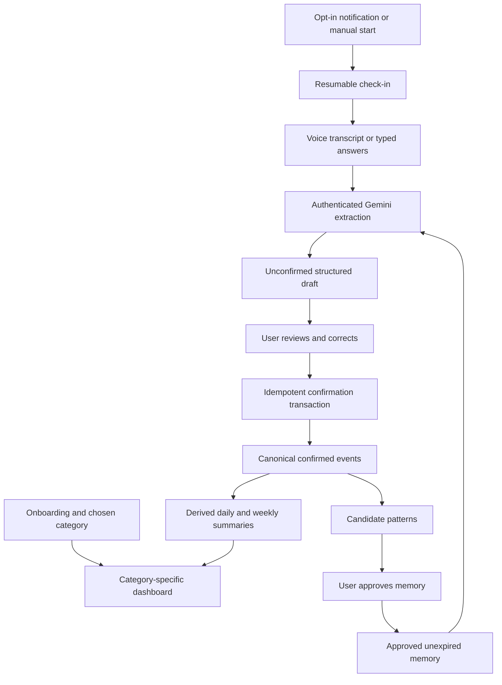

# 365 Fitness tracker: implementation coverage

Audited October 9, 2026 against the active React Native app, Firebase functions/rules and the supplied project tracker. This is a code and planning audit, not a fresh test run or production certification.

## Answer

**No—the tracker describes substantially more than we have implemented.** We have a local mobile foundation for onboarding, meals, prep, scanners, editable AI drafts and basic nutrition history. We have not completed the tracker’s notification-to-conversation-to-confirmed-daily-record journey, category-specific dashboards, workout tracking or the wider ecosystem.

The attached CSV is only the **AI Notification** sheet. The downloaded OneDrive workbook contains **12 sheets: nine visible and three hidden**. Hidden `PRODUCT` repeats module definitions, hidden `Weekly Actions` contains five planning rows, and hidden `nn` is empty. The online workbook opened in view-only mode and was not changed. A detailed implementation workbook is still in preparation; this report is the currently available audit. The October 10 screenshot requirements are captured separately in [the user feedback backlog](USER-FEEDBACK-BACKLOG.md).

## What exists and what does not

| Area | Current React implementation | Remaining frontend, backend and database work |
| --- | --- | --- |
| Onboarding | All 18 source survey topics, conditional fields, drafts, review/edit and 12-hour time entry | Live cloud setup/device checks; downstream behavior for stored preferences |
| Customer categories | Three broad goal labels | Five C01–C05 categories, classification/override rules, category versioning and dashboard selection |
| Meal planning and prep | Usual meals, six starters, serving scaling, grocery quantities, saved prep steps | Personalized full-week generation, priced budgets, swaps, device/cloud validation |
| Barcode / label / meal photos | Product lookup, review flows and server Gemini adapters | Live phone configuration, evaluation and release validation; fiber is not in the current nutrient model |
| Voice | Speech-to-text input with transcript review/fallback | Daily conversation state, question selection, turn handling and extraction across modules |
| Notification | Frequency and local check-in time collected | Permission, token registration, scheduling, deduplication, receipt handling and deep links |
| Daily record | Confirmed/skipped meal entries | Whole-day drafts, workout/lifestyle records, correction/confirmation and atomic idempotent writes |
| Progress | Food history, calories/macros and meal check-in calculations | Individual goals, weight trends, workout volume, habits, recovery and unified category-specific progress |
| Sleep / water / caffeine | No current React event capture | Input screens, units/date rules, validators, persistence, summaries and sync |
| Memory | No approved-memory lifecycle | Candidate review, explicit approval, retrieval, expiry, revocation and deletion |
| Workout AI/video/camera | No corresponding React module | Exercise/content research, constrained plans, licensed video, guided sessions and evaluated pose analysis |
| Scale / wearables / grocery commerce / professional plans / payments | Interest/budget fields and some planning documents only | Provider feasibility, consent, UI, service contracts, database schemas and release tests |

Legacy Flutter code contains additional experiments. Those do not count as implemented functionality in the current React app. Likewise, a preference field, design document, backend helper or successful API call does not complete the end-to-end feature.

## Evidence anchors

- [Profile schema](../apps/mobile/src/domain/profile.ts): all survey topics; reminders and device fields explicitly described as preferences.
- [Current AppState](../apps/mobile/src/domain/meals.ts): templates, food entries, profile and prep; no workout/sleep/hydration/caffeine/session/memory records. Nutrients contain kcal, protein, carbs and fat, not fiber.
- [History calculations](../apps/mobile/src/domain/analytics.ts): food-oriented metrics, not the broader category views.
- [Voice field](../apps/mobile/src/components/VoiceTextField.tsx) and [speech session](../apps/mobile/src/services/speech-session.ts): dictation, not a multi-turn daily assistant.
- [Server functions](../functions/index.js): text meal parsing, label/meal-photo/prep analysis and account deletion; no daily session/notification/confirmation orchestration.
- [Local storage](../apps/mobile/src/data/storage.ts): one SQLite JSON state record. A durable per-account event store/outbox is still required for automatic synchronization.
- [Profile repository](../apps/mobile/src/services/cloud/profile-repository.ts) and [prep repository](../apps/mobile/src/services/cloud/prep-repository.ts): explicit backups with listeners and revision conflict handling; not automatic diary synchronization.
- [Firestore rules](../firestore.rules): owner-scoped profile/prep rules plus broad legacy `/users/{uid}` writes. New server-owned session/summary/payment data must not inherit that wildcard permission.
- [GitHub workflow](github-workflow.md): local mobile/CI foundation remains untracked; no completed remote baseline/release should be assumed.

The last development evidence recorded before this audit was 85 passing mobile tests plus typecheck/lint and iOS/Android/web exports. These were not rerun for this documentation task. They do not prove live Firebase, physical-device behavior, benchmark accuracy, customer demand or signed-build readiness.

## Frontend, backend and database architecture to add

**Existing data stays distinguishable:** retain `mobileProfiles/{uid}` and `mobileMealPrep/{uid}` backups during migration. Proposed new event/session collections use a new `mobileUsers/{uid}` namespace, outside the legacy broad `/users` wildcard. The Data Model sheet gives fields, access boundaries and lifecycle requirements. These collections and rules have not been implemented or deployed.

**Frontend:** keep focused screens for one check-in question, editable transcript, daily summary, per-category progress and settings. Offer manual start when notifications are disabled. Every captured fact can be skipped or corrected. Preserve accessible overflow at large text sizes.

**Backend:** proposed operations are `registerDevice`, `updateNotificationPreferences`, `startDailyCheckIn`, `extractCheckInDraft`, `confirmDailyCheckIn`, `updateTrackerEvent`, and memory approval/revocation handlers. Session extraction writes a draft only. Confirm requires auth, attestation, bounded validated input, an expected draft/day revision and an operation ID. Retry of the same operation returns its existing result; the same ID with a different payload fails. Changed input during extraction must not be overwritten by a late AI response.

**Database:** store confirmed meals, workouts, lifestyle, sleep, hydration, caffeine and measurements as typed events with source, timestamps, local date/timezone, schema version and revision. Summaries are rebuildable views of those events. Store unconfirmed AI content in expiring session drafts. Keep user-approved memory separate from raw history. Introduce explicit migrations and account-isolated local records/outbox before calling this automatic sync.

**Notifications:** propose mobile push plus in-app entry initially; SMS remains an open product decision. Store IANA timezone as well as local HH:mm, schedule version, opt-in and pause state. Use server-owned delivery records and a deduplication key; do not promise exactly-once delivery from a push provider. Handle retries, invalid tokens, quiet hours, DST and changed timezone. A reminder must not expose private meal/health details on a locked screen. [Expo’s push service](https://docs.expo.dev/push-notifications/overview/) supplies a shared APNs/FCM integration path; [Firebase scheduled functions](https://firebase.google.com/docs/functions/schedule-functions) can drive server scheduling. Both still require actual setup and device testing here.

**Atomic writes:** use [Firestore transactions](https://firebase.google.com/docs/firestore/manage-data/transactions) for revision-sensitive confirmation. Persist the operation receipt and authoritative events consistently; offline drafts must remain recoverable. An offline UI must not claim a server confirmation that never succeeded. Paginate event history and bound per-day/session documents rather than appending indefinitely to a single payload.

## AI Notification: all twelve rows

| Source step | Current state | Required end-to-end outcome |
| --- | --- | --- |
| 1. Trigger | Time/frequency preference only | Opted-in scheduled push, with delivery state and pause/reschedule support |
| 2. Start | Not built | Notification opens or resumes the correct dated session |
| 3. Food | Meal tools exist; conversation missing | Follow-ups produce an editable food/drink draft |
| 4. Workout | Preferences only | Validated self-reported activity becomes a workout record |
| 5. Lifestyle | Not built | Optional category-appropriate energy/craving/sleep/context answers |
| 6. Exceptions | Meal skip exists; reason/pattern flow missing | Editable wins/blockers/deviation context without inferred judgment |
| 7. Summary | Per-meal confirmation only | Whole-day review and exactly one logical commit despite retries |
| 8. Progress | Nutrition history only | Correct category-specific daily/weekly metrics from confirmed events |
| 9. Memory | Not built; source marks Future | Only approved, relevant, unexpired memory may affect future prompts |
| 10. Sleep monitoring | Title-only requirement | Start with explicit manual sleep capture; decide sensor monitoring separately |
| 11. Water intake | Title-only requirement | Unit-aware water entry, correction and daily total |
| 12. Caffeine intake | Title-only requirement | Amount/time/source and known-or-unknown caffeine values |

Sleep, water and caffeine require acceptance decisions because the source leaves their detail columns blank. Proposed defaults: sleep attributed to wake date with timezone retained; hydration normalized to ml while preserving the original unit; caffeine mg nullable and source-labelled. One beverage can link nutrition, water and caffeine records without counting the same event twice. These are design proposals, not already approved product rules.

## Build order and completion gates

| Wave | Frontend | Backend | Database | Exit gate |
| --- | --- | --- | --- | --- |
| W0: foundation | Verified account/device build; recovery and data controls | Dev/prod Firebase, scoped deployment, auth/App Check, reviewed CI baseline | Data dictionary, migration/UID isolation, tested rules and deletion coverage | Two-device baseline works; deployment and privacy boundaries are explicit |
| W1: useful daily tracker | Five-category selection/view; manual workout, lifestyle, sleep, water, caffeine and daily review | Validated event writes and idempotent confirmation; metric definitions | Typed confirmed events, day revisions, goals, operation receipts and derived summaries | Complete the daily tracking loop manually before AI orchestration is required |
| W2: assistant | Opt-in notifications, session resume, voice/text turns and editable extracted summary | Scheduler/receipts, session state machine, Gemini extraction and bounded retries | Device tokens, delivery records, session drafts and approved confirmed commits | Notification to conversation to corrected tracker works on both phones |
| W3: personalization | Reviewed meal recommendations and swaps | Versioned constraints and quality/cost evaluation | Plan/constraint versions and provenance | Recommendations meet approved constraints and preserve history |
| Parallel discovery | Workout AI/video prototypes and professional review | Exercise/video provider and licensing feasibility | Catalog contracts and evaluated workout data needs | High-priority training discovery remains visible without claiming it is built |
| Future modules | Memory, scale, wearables, groceries/commerce and professional portals | Each provider/permission workflow independently validated | Feature-specific consent, source, access and lifecycle contracts | Separate evidence and release gate per module |

The tracker calls AI Workout / Training **high-priority discovery**. That priority is retained. The sequence above is a proposed implementation dependency order, not a decision to cancel or silently deprioritize it. The source names Shivangi, Srija and Akhil on specific research/governance rows; those ownership entries are preserved without assigning new people or sending messages.

For every implementation item, “complete” requires: UI and fallback present; backend validation/auth/errors handled; database schema/rules/migrations/lifecycle implemented; appropriate tests and physical-device QA passed; and the correct environment deployed. A local feature may satisfy only some of these gates.

## Open decisions to record

1. Final product name: workbook uses **365 Fitness**, current app uses **360° Fitness AI**, older repository material uses **Nourish**.
2. Approve category assignment/overlap and user overrides for C01–C05.
3. Select the Firebase project and deployment environments.
4. Confirm push versus SMS and whether spoken AI output is required in addition to speech input.
5. Define sleep-monitoring scope and daily date attribution; approve water/caffeine units and unknown-value handling.
6. Define transcript, media and approved-memory retention before external pilot capture.
7. Decide physical-product checkout versus digital-subscription monetization before billing implementation.
8. Resolve hiring/board and sponsor decisions in the Decision Log; these are project actions, not app features.

This audit adds implementation tasks and database contracts. It does not deploy Firebase, change the shared workbook, implement all missing modules, or mark them complete.
