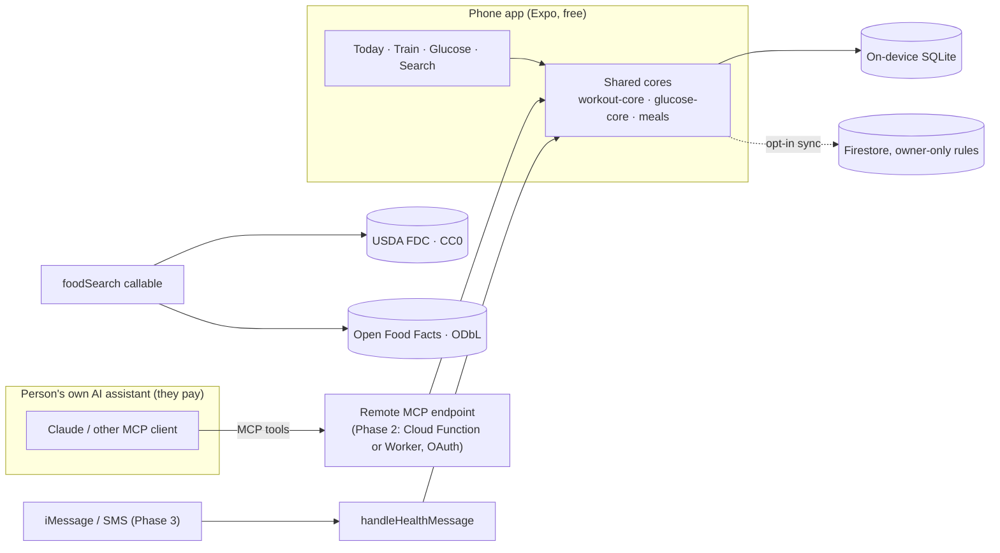

# 360 Fitness — product plan, PRD and budget (MCP-first, lean)

| | |
| --- | --- |
| **Status** | Draft for founder review · November 18, 2026 |
| **Replaces for now** | The clinic-led *Nourish US Live App PRD v0.3* (Next.js + OpenAI + clinic pilot, $83.5k–$221.9k build). That plan stays valid **if a clinic signs on**. Until then, this plan applies. |
| **Written as** | "If this were my business and I had no clients and no outside money." |
| **Companion files** | [budget-lean.csv](budget-lean.csv) · [project-tracker-v2.csv](project-tracker-v2.csv) · [data workflow](../data/DATA-WORKFLOW.md) · [live app requirements](../release/LIVE-APP-REQUIREMENTS.md) · [V2.1 review](../release/V2.1-REVIEW.md) · [Structure setup](../company/STRUCTURE-SETUP.md) |

> Not legal, medical or regulatory advice. The regulatory notes below are a map of what to ask counsel and a clinical advisor, not conclusions.

---

## 1. The decision in one paragraph

Start direct-to-consumer for adults living with **type 2 diabetes or prediabetes** who want one calm place to log food, glucose and activity. Show them their own patterns, and **bring an organised report to their doctor**. Ship it as a free, local-first phone app plus an **MCP connector**, so people can also log and ask questions inside the AI assistant they already pay for. We pay for no chat model and build no chat UI, which keeps monthly costs near zero. Pursue clinics only after real patients use and like the product. Their reports become the sales pitch.

## 2. Why this shape (and not the clinic plan first)

| Question | Clinic-led plan (uploaded PRD) | This plan |
| --- | --- | --- |
| Who must say yes before anything ships? | A clinic, its clinical lead, counsel, BAAs | One person downloading an app |
| Build allowance | $83.5k–$221.9k (contracted delivery) | **≈ $3.3k–$13.3k cash over 6 months** (founder + Claude Code; see §8) |
| Monthly run cost at 50 users | $5.5k–$13.3k (incl. clinician time) | **≈ $0–$60** technology; no staffed queue |
| AI cost | ~$4/patient/month in-app LLM | **$0** on the MCP route: the person's own assistant runs the model |
| HIPAA scope | Yes (clinic = covered entity, we = business associate) | Generally not, for a direct-to-consumer app not acting for a provider. FTC and state consumer-health-data laws apply instead (§6) |
| Biggest risk | No clinic signs | Nobody keeps using it, so §7's gates measure that early |

The clinic plan also assumed rebuilding in Next.js. We already have a tested Expo app (iOS/Android/web), Firebase rules with emulator tests, and now shared cores. Rebuilding would spend most of the budget re-creating what exists.

## 3. Who it's for

**Primary person: "Maria", 52, type 2 diabetes for 3 years.** Checks fingerstick glucose a few times a week, sees her doctor every 3 months, and is told to "watch carbs". She wants to know which meals spike her, and to walk into the appointment with something better than memory.

**Secondary:** people with prediabetes, caregivers logging for a parent, and people with other conditions (kidney, hypertension). Sakshi's health branch already withholds unsuitable generic targets for those people.

**Not for (v1):** type 1 insulin dosing, pregnancy, children, eating-disorder recovery. The app says so plainly and points to a clinician.

## 4. What the product does (PRD)

### 4.1 Jobs to be done → features

| Job | Feature | Status in this branch |
| --- | --- | --- |
| "Log what I ate in seconds, accurately" | Food search over **USDA FoodData Central + Open Food Facts**, barcode scan, usual meals, portions, explicit confirm | Search ✅ (your `u14-food-search` branch, merged) · barcode ✅ · usual meals ✅ |
| "See my carbs, not just calories" | Carbs per meal and per day; fiber | Carbs ✅ · **fiber in the meal model: TODO (P0)** |
| "Track my glucose and see what moves it" | Glucose log (mg/dL or mmol/L, context), 14-day summary, before/after-meal pairs | ✅ `packages/glucose-core` + Glucose screen |
| "Stay active toward a goal" | Weekly workout goals, quick log, streaks | ✅ `packages/workout-core` + Train tab |
| "Don't give me advice that's wrong for my condition" | Optional health context; unsuitable generic targets withheld; clinician-provided values win | ✅ Sakshi's `re-analysize-nutrient-goal` branch (merged) |
| "Let me use my AI assistant" | MCP connector: log meals/glucose/workouts, ask "how did last week go?" | ✅ local stdio server (`packages/health-mcp`) · remote connector: Phase 2 |
| "Help me at my appointment" | **Doctor report**: 30/90-day PDF/CSV of glucose, carbs, activity, with gaps visible | Phase 2 (P0 for paid tier) |
| "Text it in" | iMessage/SMS logging | Router ✅ (`handleHealthMessage`) · transport: Phase 3 |

### 4.2 Non-negotiable product rules

1. **Never invent numbers.** Unknown nutrition stays unknown, and AI or photo estimates are labelled estimates. A day without records is a gap, never zero (enforced in code: `sumNutrition`, `summarize()`).
2. **Never dose, diagnose or change treatment.** No insulin calculator and no medication advice, from the app or through the MCP. The MCP server's `instructions` tell the assistant this. Tool descriptions repeat it.
3. **Safety copy for lows/highs** points to the person's own care-team plan and emergency services (`safetyNotice()`). Before any clinic pilot, a clinician replaces the wording.
4. **Nothing is saved without confirmation.** Retries never duplicate (idempotency keys everywhere).
5. **Local-first.** Health data stays on the phone unless the person turns on backup. Each kind of data gets its own consent.
6. **One rulebook.** App, MCP and messaging call the same pure cores, so answers can't disagree.

## 5. Architecture — the budget-saving part

**Why MCP saves money:** the expensive, risky part of an "AI health companion" is the model, plus a chat UI, prompt safety, evals and per-token bills. With MCP we ship **tools and data rules**, and the person's assistant provides the conversation. Our cost per active user is the cost of a few database writes. If we later add our own in-app chat, it reuses the same tools.

**What we still pay for:** hosting a remote MCP endpoint and auth (free tiers cover the first thousands of users), plus optional in-app photo estimates (capped and switchable off; manual logging always works).

## 6. Regulatory and privacy map (verify with counsel)

| Area | Why it applies | What we do |
| --- | --- | --- |
| **FDA — device vs. general wellness** | Software that recommends insulin/medication doses or diagnoses is generally regulated as a medical device. Logging, trends and general education usually fall under general-wellness / low-risk policy | No dosing or diagnosis anywhere. Descriptive summaries only. Re-check every new feature against FDA's general wellness and clinical decision support guidance |
| **HIPAA** | Applies to covered entities and their business associates. A consumer app used on the person's own initiative is generally outside it | Stay direct-to-consumer. **The moment a clinic directs patients to us or receives data, re-scope** (uploaded PRD applies: BAA, audit, etc.) |
| **FTC Health Breach Notification Rule** (amended 2024) and FTC Act §5 | Covers health apps not covered by HIPAA. Unauthorised disclosure, including sharing with analytics/ad SDKs, can count as a breach. Health claims must be truthful | No ad SDKs, no PHI in analytics, a breach-response runbook, and claims reviewed ("helps you track", not "lowers A1c") |
| **State consumer health data laws** (e.g. Washington My Health My Data Act, Nevada, Connecticut) | Consent for collecting and sharing consumer health data, deletion rights | Separate consent for health data (already in Sakshi's flow), in-app deletion and export, and a privacy policy listing every processor |
| **App Store / Google Play** | Medical-app scrutiny, health-data rules, account deletion requirement | Clear disclaimers, in-app account deletion, no health data for ads |
| **Accessibility** | Older users, low vision, neuropathy | WCAG 2.2 AA target; large-text and screen-reader pass before public launch |

## 7. Roadmap with go/no-go gates

| Phase | When | Ship | Gate to continue |
| --- | --- | --- | --- |
| **0 · Foundation** | Weeks 0–2 | Merge this PR. Set up the company in Structure (§9). Pick the name (360 vs 365 vs Nourish). Privacy policy draft. Book a CDCES/RD advisor for ~10 hrs | Advisor agrees the safety boundary and copy are sound |
| **1 · Useful alone** | Weeks 2–8 | Data-accuracy P0s (fiber, partial totals, correction history; see the [data workflow](../data/DATA-WORKFLOW.md)). Food search on device. Glucose + workouts on Today. Doctor report v1 (CSV). TestFlight / Play internal test with **10–20 people with T2D/prediabetes** | ≥ 50% still logging in week 3. ≥ 5 say they'd show the report to their doctor. Zero data-loss bugs |
| **2 · MCP + sync** | Weeks 6–12 | Remote MCP (OAuth via Firebase Auth, owner-only Firestore). Submit to the Claude connector directory. Doctor report PDF. Opt-in backup/sync | ≥ 30% of testers try the connector. Cost per active user < $0.10/month |
| **3 · Reach** | Months 3–6 | Public store launch (free + Plus). Reminders. Apple Health / Health Connect read-only import (glucose, steps). iMessage/SMS check-ins if testers ask for them | 4-week retention ≥ 25%. First 50 paying users, or a clinic asks for a pilot |
| **Clinic track** | Only on inbound interest | Uploaded PRD's clinician workflow, BAAs, audit and pilot | Signed letter of intent |

**Business model (to test, not assume):** free core logging. **Plus ($4.99–$7.99/month)** for doctor reports, 90-day insights, messaging check-ins and unlimited photo estimates. Later, clinic seats priced per patient per month, once the clinical evidence and compliance exist.

## 8. Budget — realistic and lean

Full line items and formulas: [budget-lean.csv](budget-lean.csv). All USD, **estimates to confirm against current vendor pricing**.

| Bucket (first 6 months) | Low | High | Notes |
| --- | --- | --- | --- |
| Store accounts, domain | $140 | $160 | Apple $99/yr, Google $25 one-time, domain ~$15–35/yr |
| AI dev tools (Claude Code) | $120 | $1,200 | Pro to Max subscription × 6 months |
| Hosting, DB, auth, MCP endpoint | $0 | $300 | Firebase/Workers free tiers, then pay-as-you-go |
| Clinical advisor (CDCES / RD) | $750 | $3,000 | 10–20 hrs × $75–150 reviewing safety copy, education, report design |
| Legal: privacy policy, terms, claims review | $1,500 | $5,000 | Health-app-literate attorney; flat-fee packages exist |
| User research incentives | $250 | $800 | 10–20 testers × $25–40 |
| Design polish (icon, store screenshots) | $0 | $600 | Optional; Claude + Figma community can cover most |
| **Subtotal** | **$2,760** | **$11,060** | |
| Contingency 20% | $552 | $2,212 | |
| **Total cash, 6 months** | **≈ $3.3k** | **≈ $13.3k** | Founder time not included |

**Monthly technology run-rate after launch** (≈ 500 active users): **$0–$60**, plus optional iMessage/SMS ($30–$300/month depending on provider and volume) and optional photo estimates (cap at ~$0.002 per scan, with a monthly ceiling).

**Compared with the uploaded clinic plan:** ~95% less cash before the first real user. The trade-off is that the founder does the building with Claude, and clinical/legal review is bought by the hour instead of retained.

## 9. How we run it with Claude + Structure

[Structure](https://runstructure.com/) writes a company down as plain files (mission, voice, departments, roles, skills) and compiles them into `CLAUDE.md` / `AGENTS.md` that Claude Code reads. For a solo founder that means every Claude session starts knowing the mission, the safety boundary and how decisions get made. You don't have to re-explain it each time. Setup answers are pre-written in [STRUCTURE-SETUP.md](../company/STRUCTURE-SETUP.md).

| Department / role | Who | What Claude does | What a human must own |
| --- | --- | --- | --- |
| Product | Founder | Drafts PRDs, trackers, release notes, synthesises tester feedback | Scope and priority decisions |
| Engineering | Founder + Claude Code | Builds features with tests, reviews diffs, runs CI fixes, writes migrations | Merges to `main`, releases, secrets |
| Clinical safety | Advisor (hourly) | Drafts education and safety copy, and builds evaluation cases | **Approves every line of safety/clinical copy** |
| Privacy & legal | Attorney (hourly) | Keeps the processor list, data map and policy drafts current | Final policy and claims sign-off |
| Growth | Founder | Store listing, diabetes-community posts, tester outreach drafts | Voice and community relationships |

**Weekly operating rhythm (1 hour):** Monday, review the tracker CSV and CI. Wednesday, read 5 tester messages. Friday, ship a TestFlight build. Monthly, check spend per active user and the gates above.

## 10. Risks

| Risk | Likelihood | Mitigation |
| --- | --- | --- |
| People stop logging after week 2 | High | Quick-log text, usual meals and messaging. Measure week-3 retention in Phase 1 before building more |
| Wrong nutrition data harms trust | Medium | USDA-first search, unknowns stay unknown, provenance shown, correction history |
| A user treats the app as medical advice | Medium | Hard boundary in code and MCP instructions, safety notices, advisor-approved copy |
| MCP adoption is niche | Medium | MCP is a cheap add-on, not the only path. The app stands alone |
| Founder bandwidth | High | Phase gates, one condition focus, Structure + Claude for repeatable work |
| Data breach | Low/High impact | Local-first, owner-only rules with emulator tests, no ad SDKs, CI secret scanning, breach runbook |

## 11. Open decisions for the founder

1. Final name: **360 Fitness**, **365 Fitness** or **Nourish**? (Store listing and domain depend on it.)
2. Confirm the first focus is **T2D + prediabetes, direct-to-consumer**.
3. Approve a ≤ $1,000 first spend: advisor intro session + store accounts.
4. Approve merging this PR (it also merges Sakshi's health branch and your food-search branch).
