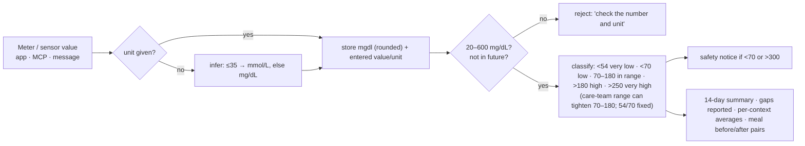

# Data workflow — meals, glucose and workouts

**Goal:** the numbers a patient sees, and later shows their doctor, must be accurate and honest about what is unknown. This document traces every record from input to screen, using the sample day in [sample-health-day.json](sample-health-day.json). **That sample was generated by running the real domain code**, not typed by hand.

Status: November 18, 2026 · branch `claude/fervent-babbage-qqaz08` (includes the food-search and health-aware branches).

## 1. Principles (enforced in code)

| Rule | Where |
| --- | --- |
| Planned ≠ eaten. Only `confirmed` entries count | `dailyNutrition()` in `apps/mobile/src/domain/meals.ts` |
| Unknown nutrition is `null`, never 0 | `Nutrients` type, `sumNutrition()`, `foodSearch.js` (`per100` nulls) |
| A day without records is a gap, not zero intake | `historyDays()`, glucose `summarize().daysWithReadings` |
| Retries never duplicate | meals: one entry per (meal id, date) · workouts/glucose: `idempotencyKey` |
| Every value carries its source | `Food.source` (sample/manual/ai/barcode), glucose `entered.unit` + `source`, workout `source` |
| Implausible values are rejected, not stored | `validateMeal`, `validateReading` (20–600 mg/dL), `validateSession`, USDA/OFF per-100 caps |
| Corrupt saved data is never overwritten | `parseSavedState()` throws, and the store shows an error instead of saving defaults |

## 2. Meal workflow

```mermaid
sequenceDiagram
  participant P as Person
  participant UI as App (Today / Search / Meal editor)
  participant S as foodSearch callable
  participant D as Domain (meals.ts)
  participant DB as On-device SQLite
  P->>UI: search "oats" / scan barcode / pick usual meal
  UI->>S: query (only the text or barcode is sent)
  S-->>UI: candidates per 100 g · source USDA or OFF · nulls kept
  P->>UI: choose portion, edit values
  UI->>D: validateMeal → recordMeal(state, meal, date, "confirmed")
  D->>DB: save whole state (queued; UI updates only after the write succeeds)
  DB-->>UI: Today + History recompute totals from confirmed entries
```

### Sample day (from `sample-health-day.json`)

| # | What happened | Confirmed kcal / carbs | Entries | Behaviour |
| --- | --- | --- | --- | --- |
| 1 | Usual breakfast exists in My Plan | 0 / 0 | 0 | Templates are plans, not intake ✅ |
| 2 | Breakfast confirmed eaten | 300 / 45 g | 1 | ✅ |
| 3 | Same confirmation retried | 300 / 45 g | 1 | No duplicate ✅ |
| 4 | Oats corrected 40 g → 60 g | 375 / 58.5 g | 1 | Portion rescales every nutrient ✅. **Old version is overwritten (no history)** ⚠️ |
| 5 | Lunch confirmed with one item of unknown nutrition (soda, size unknown) | **— / —** | 2 | Never understates ✅. **The whole day goes blank** ⚠️ |
| 6 | Dinner skipped | — / — | 3 | Skips are recorded but excluded ✅ |

### Gaps found (become tracker items D01–D03)

| ID | Gap | Why it matters for patients | Fix |
| --- | --- | --- | --- |
| **D01** | **Fiber isn't in the meal model** (only kcal/protein/carbs/fat). Sakshi's targets already compute a fiber target | Fiber is central to diabetes nutrition education, and people compare carbs with fiber | Add `fiber` to `Nutrients`, map USDA nutrient 1079 / OFF `fiber_100g`, show it |
| **D02** | **One unknown item blanks the day's totals** | A person who logs everything except one coffee sees nothing useful | Show the known subtotal plus "1 item unknown" (`{ value, unknownItems }`). Averages keep using complete days only, as now |
| **D03** | **Entry id = template id**, so the same usual meal can't be eaten twice in a day, and corrections leave no history | Inaccurate totals and no audit trail for the doctor report | Unique entry ids, `revision` + `previous` on correction, stale-edit check (uploaded PRD R05/R06) |

## 3. Food data sources and accuracy

| Source | Licence / cost | Strength | Caveat | How we use it |
| --- | --- | --- | --- | --- |
| **USDA FoodData Central** (Foundation, SR Legacy, Survey/FNDDS, Branded) | Public domain (CC0); free API key | Lab-analysed generic foods; best for "banana", "cooked rice" | Branded entries are manufacturer-reported | Default for generic foods; energy falls back across nutrient ids 1008/2047/2048 |
| **Open Food Facts** | ODbL; free; identify with a User-Agent | Huge barcode coverage | Crowd-sourced, so typos happen | Barcodes and packaged foods; per-100 plausibility caps; show "check the label" |
| **Manual entry** | — | Exactly what the label says | Typos | Range validation (0–10,000) and unit required |
| **AI photo estimate** (optional) | Per-scan cost | Fast | Portions are guesses | Always marked `ai`, always editable, never auto-confirmed |

## 4. Glucose workflow



Sample results: readings 112 (fasting), 118 (before breakfast), 171 (2 h after breakfast), 64 (before lunch) → average **116 mg/dL**, **75% of readings in range**, one low reading with a safety notice, and a breakfast rise of **+53 mg/dL over 120 min**. Fingerstick summaries say "readings in range", not "time in range". Only all-CGM data earns that label.

## 5. Workout workflow

Logged from the app, MCP or a message → `dispatch()` validates → `idempotencyKey` (message id for texts) de-duplicates → weekly goal progress. Sample: a 30-minute walk texted twice with the same message id produces **one** session, giving 30/150 active minutes this week.

## 6. Where data lives and who can see it

| Data | Default | Optional | Never |
| --- | --- | --- | --- |
| Profile answers | Device | `mobileProfiles/{uid}` backup (owner-only rules, emulator-tested) | Analytics |
| Health conditions | Device | `mobileHealthProfiles/{uid}` with separate consent (Sakshi's branch) | Shared without consent |
| Meals, glucose, workouts | Device (SQLite) | Phase 2: owner-only Firestore sync | Ad/analytics SDKs |
| Food search query | Sent to our callable → USDA/OFF | — | Diary, profile or health data |
| MCP (local) | `~/.360fitness/health.json`, file mode 0600 | Phase 2: remote with OAuth | Other users' data |

## 7. Doctor report (Phase 2 design note)

For each day in the range: confirmed carbs (with unknown-item count), fiber, glucose readings by context, workouts, and **explicit "no records" rows**. The footer lists data sources and "estimates are labelled", plus the generation date. Export as CSV first, then PDF. The clinical advisor reviews the layout before release.
