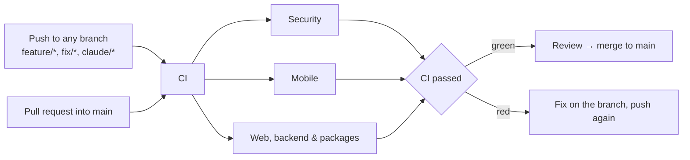

# GitHub and release workflow

Publication target selected by the owner on 2026-10-10: `srijavuppala/360fitness` (public), branch `main`. The prior `srijavuppala/nourish` history is retained; its remote is preserved as `nourish` when configuring the new origin.

The initial publication includes the React apps, required Firebase code/rules, documentation and CI. Local credentials, machine configuration and unrelated pending Flutter modifications are excluded. Existing history still contains the historical Flutter prototype. New feedback requirements are tracked by U-ID in [the backlog](USER-FEEDBACK-BACKLOG.md).

## Reviewable delivery

1. Review `git status` and select the React app, required Firebase backend/rules, docs, lockfiles and CI files as the initial mobile baseline. Inspect public-repository contents before publishing.
2. Never stage `.env.local`, provider keys, service accounts, signing files, dependency symlinks or generated bundles. The ignore files cover common local configuration; ignore patterns are not a substitute for a secret scan.
3. Use `feature/<change>` (new work or refactors), `fix/<change>` (bug fixes) or `docs/<change>` branches and a PR into the actual default branch. Keep UI, domain/service, security-rule and verification details in the PR. The template prompts for data/deployment effects.
4. Required validation: mobile export for all platforms, mobile typecheck/lint/tests, generated-rule drift check, website check, backend tests and Firestore emulator authorization/schema tests.
5. After the baseline exists remotely, enable branch protection/rulesets with these checks, block force pushes/deletion and require review when another reviewer is available. No branch protection or default-branch rename was performed here.
6. Merge only after checks and review. Use a separate explicit release step for Firebase and EAS. CI has read-only repository permissions and does not deploy or hold production secrets.

Both CI workflows run on all PRs, so path filters cannot leave a required check permanently pending. Mobile export runs before typecheck to generate Expo Router types on a fresh checkout. Jobs have timeouts and cancel superseded runs.

Before production, pin action revisions to reviewed commit SHAs, enable secret scanning/dependency alerts available for the repository, address dependency vulnerabilities, and configure environment approvals for deployment workflows. Rename the default branch to `main` only as a coordinated repository operation; do not silently change the shared default.

Reference: [GitHub Actions least-privilege token permissions](https://docs.github.com/en/actions/tutorials/authenticate-with-github_token).

## One CI pipeline for every branch (November 2026)

`.github/workflows/ci.yml` is the single entry point. It runs on **every push to every branch**, on **every pull request**, and on demand (Actions → CI → Run workflow). It calls three building blocks:

| Stage | File | What it checks |
| --- | --- | --- |
| Security | `security.yml` | gitleaks secret scan, npm audit gate (mobile/web/functions), dependency review on PRs, CodeQL (TypeScript + workflow files). Also runs weekly on its own |
| Mobile | `mobile.yml` | Expo export for all platforms, typecheck, lint, tests, rules drift |
| Web, backend & packages | `web.yml` | Website lint/tests/build, Cloud Functions tests, Firestore emulator rule tests, shared packages (`workout-core`, `glucose-core`, `health-mcp`) |
| **CI passed** | `ci.yml` | Fails if any stage failed or was cancelled |

**Branch flow:** create `feature/<name>` (or `fix/`, `docs/`) from `main` → push. CI runs on the branch → open a PR. CI runs on the merge result → review → merge. A local `.githooks/pre-push` guard (`git config core.hooksPath .githooks`) blocks secrets before they leave your machine.

**Make `main` require it (owner, once):** Settings → Rules → Rulesets → New branch ruleset → target `main` → enable *Require a pull request before merging* and *Require status checks to pass* → add **CI passed** → enable *Block force pushes*. Require only this one check; it already depends on every stage.

**Dependency review prerequisite:** enable Settings → Code security → **Dependency graph**. Until then the dependency review job posts a warning instead of running, and the npm audit gate still blocks high/critical advisories.
