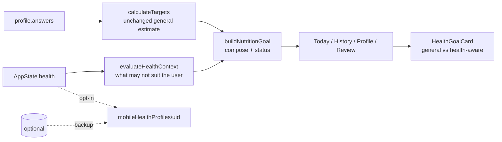

# Health-aware onboarding and nutrition goals

360Fitness gives **general nutrition and wellness estimates**. It is not a medical
diagnosis or treatment tool. This feature lets people optionally say whether a
health condition may affect their nutrition, and stops the app from presenting a
general fitness target as suitable when it may not be.

## 1. Onboarding questions

A new optional **Health & Medical Information** screen (`apps/mobile/src/app/health.tsx`)
follows the profile review during first-time onboarding. It is reachable later from
**Profile → Health & medical information**.

1. Intro, plain-language consent notice and the general disclaimer. Choices: *Continue* or *Skip for now*.
2. **Conditions** (multi-select, optional): Kidney-related condition, Diabetes (Type 1 / Type 2),
   High blood pressure (Hypertension), Liver-related condition, Thyroid-related condition,
   Heart-related condition, Other health condition (optional short note), None of the above,
   Prefer not to disclose. *None of the above* and *Prefer not to disclose* are mutually exclusive.
3. **Dietary restrictions** because of a health condition or professional recommendation:
   Yes (optional note) / No / Not sure / Prefer not to disclose.
4. **Professional guidance** on dietary or nutritional restrictions: same options.
5. If Kidney-related is selected: an optional field for a **daily protein target given by the user's
   nephrologist or dietitian**.

Nothing is mandatory. Skipping never blocks the app. Users can edit or **remove** all health data at any time.

## 2. Data model

Health data is **not** part of `profile.answers`. Profile answers are required, validated and
backed up as a unit; health data is optional, separately consented and local by default.

```text
AppState.health?: HealthProfile            (on device; absent = never answered)
  version: 1
  consentGivenAt, updatedAt
  conditions?[], conditionOther?
  dietaryRestrictions?, dietaryRestrictionsNote?
  professionalGuidance?, professionalGuidanceNote?
  clinicianProtein?: { grams, enteredAt }   whole grams/day, entered by the user
```

The clinician value is bounded only to catch typos (1 to 500 g). Those bounds are not clinical limits.

Optional cloud backup (separate consent, user-initiated, in **Account & backup**):

```text
mobileHealthProfiles/{uid}
  schemaVersion, revision, generation, backupConsent: true, health, updatedAt
```

Existing `mobileProfiles` documents are untouched.

## 3. Calculation flow

Three separate layers, none mixed into another:



- `domain/targets.ts` is **unchanged**: Mifflin-St Jeor x activity, adjusted for pace, with safety floors;
  protein 1.6 g/kg, fat 30% of kcal, carbs the remainder, fiber 14 g per 1000 kcal.
- `domain/health-context.ts` holds a reviewable **table** of which conditions withhold which general
  estimates. It has no medical numbers or formulas.
- `domain/nutrition-goal.ts` composes the result: the unchanged `generalTarget`, per-nutrient
  `displayedTarget` (value plus source, or `null` when withheld), `recommendationStatus`,
  `requiresProfessionalReview`, `source`, `calculationVersion` and `calculatedAt`.
- Goals are recalculated from stored inputs on use. They are cheap and pure, so nothing but user
  input is persisted. This keeps results idempotent and never stale. Only the app runs this logic, in
  one module, so there is no second copy to disagree with it (the companion website has manual targets only).

## 4. Recommendation statuses

| Status | When | What the user sees |
| --- | --- | --- |
| `GENERAL_RECOMMENDATION` | Health info given, no condition declared, no professional advice | General estimate |
| `GENERAL_WITH_ADVISORY` | A non-kidney condition or professional dietary advice declared | Same general estimate plus "check with your care team" |
| `INSUFFICIENT_INFORMATION` | Never answered, skipped, declined, or "Not sure" | Same general estimate, labelled as such. **Not** treated as "no conditions" |
| `REVIEW_REQUIRED` | Kidney-related condition declared | Protein and carbs shown as **Needs review** (withheld on purpose); calories and fat still shown |
| `CLINICIAN_PROVIDED` | Kidney-related plus a value the user entered | That value labelled "From your care team", not verified by the app; carbs remain withheld |

Carbohydrate is derived from protein in the general formula, so it is withheld whenever protein is.
No condition produces a lower or alternative number: displayed values are either the unchanged general
estimate or the user's own clinician value. Adding another condition rule is a data change in
`conditionRules` and should be clinically reviewed.

## 5. Security and privacy

- Local-first: health answers stay on the device unless the user chooses a backup.
- `mobileHealthProfiles/{uid}` is owner-only with a verified email, schema-validated (option lists, exclusivity,
  note lengths, conditional fields, revision progression, server timestamp). It is deliberately **not** under
  `users/{uid}/**`, whose wildcard rule has no validation.
- `deleteAccount` also deletes `mobileHealthProfiles/{uid}`.
- No logging, analytics or error text includes health answers (validation errors are generic;
  `tests/health-privacy.test.ts` asserts no logging or analytics in health code).
- Collected data is minimal: no reports, prescriptions or histories. Free text is short and optional.
- DPDP Act 2023 / Rules 2025: the consent notice is plain-language and itemised, consent is separate from
  signing in, users can edit, withdraw and delete. This is an engineering implementation, **not legal advice**.
  Commencement dates, retention periods, a formal privacy notice and any Data Protection Impact Assessment
  need review by counsel before launch.

## 6. Backward compatibility

- `AppState.health` is optional; saved data without it opens unchanged. A corrupt copy is dropped
  rather than blocking the app.
- Existing users are not sent through onboarding again. Their current goals continue unchanged,
  labelled "health information not provided", with a prompt on Profile.
- `saveProfile` preserves `health`. Reset local data clears it.

## 7. Testing

- `tests/health.test.ts`: selection rules, Other, notes, edit/remove, validation, saved-state compatibility.
- `tests/nutrition-goal.test.ts`: unchanged general calculation, every status, kidney withholding, clinician labelling, existing users.
- `tests/health-privacy.test.ts`: rules/app option sync, no logging or analytics, cloud parse validation.
- `functions/test/firestore-rules.test.js` and `apps/mobile/tests/integration/health-repository.test.ts`
  (need the Firestore emulator and Java 21+): owner access, other user, unauthenticated, unverified, invalid input.

## 8. Known limitations and future work

- Only kidney-related conditions withhold targets. Other conditions show an advisory. Extending this needs
  clinician input, not code alone.
- The protein figure in the general estimate (1.6 g/kg) predates this feature and has no in-code citation.
- Sodium, potassium, phosphorus and glucose-related targets are not tracked.
- Health data is not synced between devices unless the user backs it up manually.
- The companion website does not collect health information.
- The rules option lists are hand-written (guarded by a drift test) rather than generated.
- Wording has not been reviewed by a dietitian or clinician, and no clinical validation is claimed.

## 9. Public research behind the design

Industry practice (publicly documented): general estimates from body metrics and activity, manual goal
overrides with "consult a doctor or registered dietitian" messaging
([MyFitnessPal goals](https://support.myfitnesspal.com/hc/en-us/articles/360032625391-How-does-MyFitnessPal-calculate-my-initial-goals),
[customising goals](https://support.myfitnesspal.com/hc/en-us/articles/360032274432-Customize-your-nutritional-goals)),
medical conditions collected in onboarding with an informational-only disclaimer
([HealthifyMe terms](https://www.healthifyme.com/terms-of-use/)).
Clinical context: kidney protein targets depend on CKD stage, dialysis and diabetes and are set under
supervision ([KDOQI 2020](https://www.ajkd.org/article/S0272-6386(20)30726-5/fulltext),
[Indian J Nephrol](https://indianjnephrol.org/how-to-give-dietary-advice-to-patients-with-kidney-disease/)).
Privacy: [DPDP Rules 2025](https://www.dpdpa.in/dpdpa_rules_2025/dpdpa_rules_english_2.pdf).
Withholding a target, side-by-side comparison, and clinician-value labelling are **our own** product decisions,
not documented industry practice.
