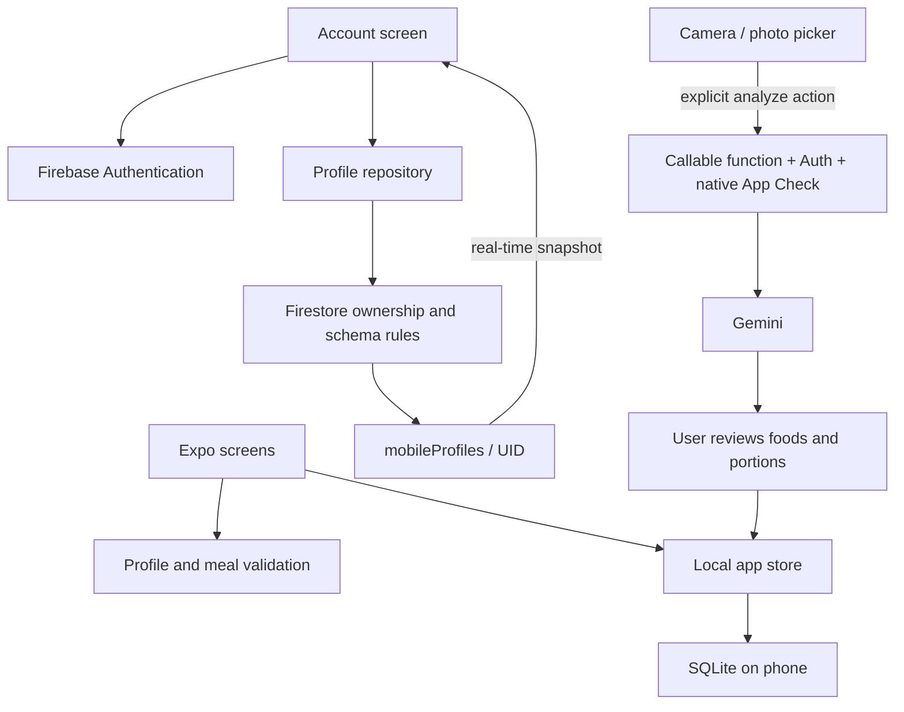

# 360° Fitness AI — mobile architecture

Status: working foundation, not a production release. Updated 2026-10-08.

## Decisions

| Area | Choice | Reason / current boundary |
| --- | --- | --- |
| Product | React Native + Expo 57 + Expo Router | One iPhone/Android codebase; web is a preview, not the phone runtime. |
| UI | `apps/mobile/src/app` and `components` | Screens compose reusable UI; rules and validation stay outside components. |
| Business rules | `apps/mobile/src/domain` | Framework-independent profile validation, meal portions and AI-result parsing. |
| Local persistence | SQLite on phones; localStorage in browser previews | Onboarding drafts, completed profile and meals survive restart without an account. Current single state record needs migration before large histories. |
| Account identity | Firebase JS Authentication with native AsyncStorage persistence | Works in Expo Go. Email/password sign-in, verification, reset, anonymous AI identity upgrade. No passwords saved by application code. |
| Cloud profile | Cloud Firestore `mobileProfiles/{uid}` | Owner-only verified account access, live snapshot subscription and optimistic revision checks. Separate from legacy Flutter `/users` documents. |
| AI | Firebase callable functions → Gemini | Provider secrets stay server-side. Shared user UID for account and AI; native App Check still requires a configured development/release build. |
| Public products | Open Food Facts | Barcode lookup sends a barcode. Do not interpret missing allergens as safe. |
| Delivery | GitHub Actions validation; EAS builds | No automatic deployment or cloud billing changes in this pass. |



## Onboarding and cloud lifecycle

1. Each onboarding step saves a local draft. Final review validates and saves the completed local profile.
2. The routine screen offers **Save my profile to an account**; Profile also has **Account & cloud profile**.
3. Sign in/create an account and verify email. Signing in does not upload, restore or overwrite anything.
4. **Review cloud save** shows the destination and explains which answers are sent. Confirmation stores the entire completed profile, including any provided metrics/allergies. Drafts/meals/photos are excluded.
5. A Firestore listener displays changes from another device. It never overwrites unsaved local answers automatically.
6. **Review restore** explicitly replaces local profile/draft while retaining meal data. Cloud and local copies can differ until the user saves/restores again.
7. Writes use a transaction against the revision and generation captured when review opened. Concurrent modification causes a conflict instead of a silent overwrite. Offline transactions fail visibly; the local profile remains and the user can retry. There is no durable automatic sync queue yet.
8. Sign-out stops the account subscription and retains local data with a visible explanation. This is a single local workspace, not separate local stores for each account. Confirm before saving it to a different account.

Cloud document:

```text
mobileProfiles/{firebaseAuthUid}
  schemaVersion: 1
  revision: integer >= 1, increments by exactly one
  generation: immutable random ID, changes if a deleted document is recreated
  updatedAt: Firestore server timestamp
  profile:
    version: 1
    updatedAt: ISO timestamp of local profile edit
    answers: validated known onboarding keys
```

`firestore.rules` is the server-side authorization boundary. Its mobile schema section is generated from onboarding questions by `scripts/profile-rules.ts`; CI checks for drift. Authentication alone is not authorization. The older `/users` rules remain for legacy consumers and must be reviewed before a broader release. AI quota documents are not client-readable.

## Live Firebase setup still required

1. Supply the existing Firebase project ID or select a new project in Firebase Console. Use separate development and production projects.
2. Enable Authentication → Email/Password. Enable Anonymous only if supporting AI before account registration. Configure password policy, authorized domains and verification/reset email templates.
3. Create Cloud Firestore in the chosen region, with production access rules. Register a Firebase **web app** to obtain the public JS SDK configuration, even for Expo Go.
4. Copy the four `EXPO_PUBLIC_FIREBASE_*` values from `apps/mobile/.env.example` into ignored `.env.local`. Restart Metro. Never add Gemini keys or service-account JSON to client environment variables.
5. Deploy only the reviewed rules using an explicit project: `firebase deploy --only firestore:rules --project YOUR_PROJECT_ID`. Test in development before production. No deployment has been made by this change.
6. Create and verify a test account; finish onboarding, save, sign in on another device and restore. Test concurrent edits, offline failure, sign-out and permission errors.
7. Native AI additionally needs matching iOS/Android Firebase app configuration, App Check and deployed callables. The JS and native Firebase project IDs must match. Expo Go cannot perform native attestation.

## Release work still open

- Authenticated physical-device QA for iOS/Android, including persistence and recovery; live cloud verification.
- A durable, UID-scoped sync queue with explicit conflict resolution if automatic sync is added.
- Account deletion in the mobile UI with reauthentication. The existing backend deletion function now removes the mobile profile too; it still requires App Check and a configured native build.
- Separate local workspaces/clear-local-data controls for shared devices and account switching.
- Diary/meal history schema and pagination, migrations from the local single record, backup/restore policy.
- Privacy policy, retention/deletion behavior, consent for photos, age-appropriate flows and store disclosures.
- Production App Check enforcement strategy for direct Firestore access (Expo Go cannot supply native App Check), abuse limits, monitoring, crash reporting and billing alerts.
- Resolve dependency audit findings: the current `npm audit --omit=dev` reports 31 findings (21 high, 10 moderate), including Expo/Metro dependency chains. Suggested automatic fixes include incompatible SDK downgrades; no forced downgrade was applied. Do not label this build production-ready based only on passing tests.
- Signed EAS builds, store review and production credentials. JS bundle exports are not installable signed builds.

## References

Patterns checked against primary sources, not copied from an unrelated starter:

- [Expo: Firebase JS SDK vs React Native Firebase](https://docs.expo.dev/guides/using-firebase/)
- [Firebase: password authentication](https://firebase.google.com/docs/auth/web/password-auth)
- [Firestore: real-time listeners and unsubscribe](https://firebase.google.com/docs/firestore/query-data/listen)
- [Firestore: transactions, retries and offline limitations](https://firebase.google.com/docs/firestore/manage-data/transactions)
- [Firebase: security rules](https://firebase.google.com/docs/rules/basics)
