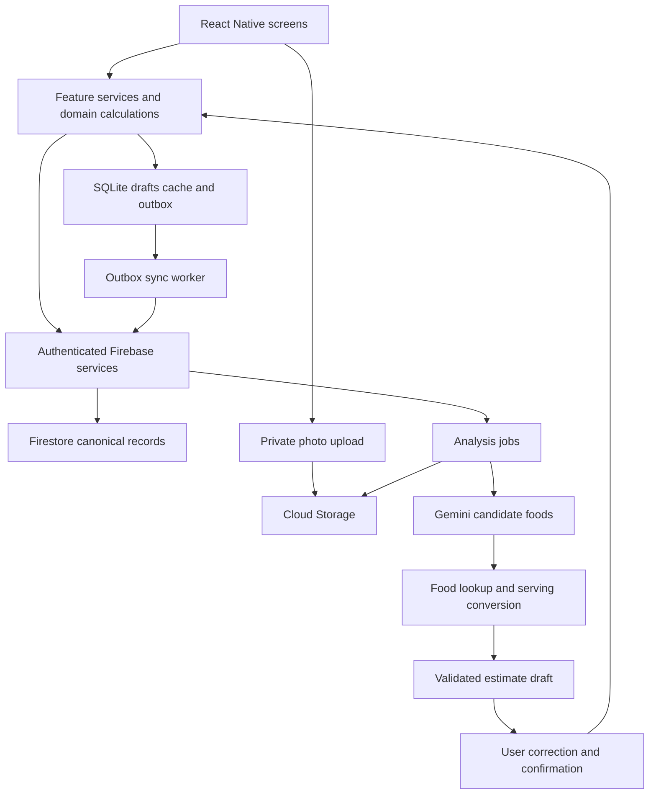

# 360 Degree Fitness AI React Native implementation plan

Version 0.5 · October 5 2026 · React Native-only direction reconfirmed by the user · Brand and delivery scope proposed

Build the app for iPhone and Android with React Native, Expo and TypeScript under the proposed brand 360 Degree Fitness AI. Deliver it in phases that each produce a usable demonstration and evidence that the phase goal works. This document explains what to build, how the features connect, and when each phase is complete.

The user confirmed iPhone and Android with React Native and explicitly excluded Flutter from new development on October 5, 2026. Build the new client exclusively with React Native, Expo and TypeScript in `apps/mobile`. The repository contains the active React Native local demo in `apps/mobile`, an earlier Flutter prototype and Node/Firebase services. Keep existing prototype files and user changes intact as historical reference, without making Flutter setup, feature work or tests a dependency of the new app. Reuse backend capabilities only after contract and security verification.

The companion [tech stack decisions](TECH-STACK-DECISIONS.md) records the choices, rationale, trade-offs and revisit conditions for this React Native app.

**Reference update:** [Product references and Superpowers workflow](REFERENCES-AND-BUILD-WORKFLOW.md) records the reviewed sources, their limits, screen refinements and a sample feature task. It informs this plan without changing the confirmed platform or expanding the beta to every competitor feature.

This plan supersedes the Flutter recommendation and delivery sequence in sections 8 and 13 of the original `Nourish-PRD.md` and `Nourish-PRD.docx` version 0.1. Their product principles and acceptance criteria remain the baseline except where this plan explicitly refines them. The Figma mobile screens remain the design reference; its existing technical architecture diagram describes the earlier Flutter proposal and needs updating before the next client presentation.

## 1 Product and release decisions

**Product promise:** describe usual meals once, check in quickly, and use text or a photo to record a different meal. Always distinguish a planned meal, an AI draft and confirmed intake.

**Confirmed:** React Native with Expo and TypeScript is the sole mobile stack; iPhone and Android. No new Flutter development.

**Proposed brand:** the user is considering **360 Degree Fitness AI**. Suggested compact display treatment: **360° Fitness AI**. Both remain tentative. Nourish remains the identifier in the existing repository, original PRD and Figma concept until a branding update. The broader name does not change the agreed planning scope or add workout coaching to the first release.

**Working assumptions:** adult users, English, four main tabs, existing Firebase backend direction, optional calorie targets. Audience, launch country, target policy, login methods, budget and team capacity still need agreement.

**Recommended release scope:** account and onboarding; reusable meals; daily logging; portion changes; calorie and macro totals; text AI; reviewed photo AI; history; optional reminders; offline recovery; export and deletion. This includes photo AI before the wider beta, while keeping an earlier internal core milestone independent of AI readiness. This is a proposed scope, not a commercial commitment.

**Later releases:** barcode lookup, recipes, weight trends, subscriptions, wearable integration and coach accounts. Water or lightweight activity tracking can follow the core gate if needed; neither should automatically change a calorie allowance.

**Status — October 6, 2026:** the React Native foundation now exists in `apps/mobile`, with setup, four tabs, a manual meal editor, local-demo persistence and check-ins. The black-and-yellow design has been refined and browser-checked. TypeScript, linting and domain tests pass. Phase 1 remains in progress: signed builds, physical-device checks and native Firebase/App Check feasibility are not yet verified. Later production phases remain pending. See [implementation evidence](../../apps/mobile/qa/VERIFICATION.md).

## 2 Technology and responsibilities

| Layer | Proposed choice | Responsibility |
| --- | --- | --- |
| Mobile UI | React Native, Expo, TypeScript | Native iOS/Android screens, forms, camera and accessibility |
| Navigation | Expo Router | Auth routes, onboarding, four tabs and focused logging screens |
| UI state | Feature hooks and reducers | Form drafts and explicit loading, review, error and saving states |
| Device persistence | Expo SQLite behind repositories | Cached plans, drafts and a durable queue of unsent meal operations |
| Firebase integration | React Native Firebase in Expo development builds | Auth, authenticated callables, reads, Storage and native App Check integration |
| Backend | Existing Node Cloud Functions; shared versioned contracts | Authorization, logging transactions, analysis jobs, quotas, export and deletion |
| Cloud data | Firestore and private Cloud Storage | Canonical account/meal records and temporary photo objects |
| AI | Server-side Gemini adapter | Propose foods, portions and clarification questions |
| Nutrition | Server-side USDA adapter plus explicit manual fallback | Match food records and normalize serving units |
| Quality | Domain unit tests, React Native component tests, Firebase emulator tests, device E2E | Verify behavior and recovery at the appropriate layer |
| Distribution | Expo development builds, then store test tracks | Device demos, controlled beta and eventual store release |

Choose and pin mutually compatible package versions during Phase 1. Avoid carrying a guessed version list into implementation. React Native Firebase uses native code and requires a development build rather than Expo Go. Expo documents both native Firebase and JS SDK options; the native option is our mobile-first architecture choice. [Expo Firebase guide](https://docs.expo.dev/guides/using-firebase/)

React Native recommends a framework for new applications; Expo is the selected framework here. A production browser application would be additional scope, with its own persistence and capability checks. [React Native setup](https://reactnative.dev/docs/environment-setup)

## 3 User and technical architecture

User navigation:

```text
Welcome → Sign in → Preferences → Usual meals → Review setup → Today

Today ── Check in → Usual / Change portion / Skip / Replace → Confirm
      └─ Add meal → Manual / Text / Photo → Review foods → Confirm

My Plan → Add / Edit / Reorder / Remove usual meals
History → Select date → Review and edit logged entries
Profile → Preferences / Targets / Reminders / Export / Delete account
```

Technical flow:



The mobile client never receives AI or USDA secrets. Services derive ownership from verified authentication. App Check supplements authorization. An AI job can create a draft but cannot create confirmed intake. The logging service is the only writer of canonical meal entries and day summaries.

**Local/cloud ownership:** SQLite holds drafts, pending operations and materialized read data; Firestore is canonical once a write is acknowledged. Firestore subscriptions refresh the local read model. All logged-meal mutations use the explicit outbox and server endpoint, avoiding two independent write queues. Pending changes overlay the last server state once, keyed by entry ID. Profile preferences may use a simpler last-write-wins policy, documented separately.

## 4 Milestones and phase order

| Phase | Goal | Demonstration at completion |
| --- | --- | --- |
| 0 | Settle product rules and contracts | Agreed scope, flows and decisions |
| 1 | Build a usable mobile shell | Navigate the designed screens on both platforms |
| 2 | Establish private accounts and onboarding | Sign in, resume setup and sign out safely |
| 3 | Create meals without AI | Build and edit a reusable breakfast with real persistence |
| 4 | Make everyday logging reliable | Log, change, skip and recover an offline check-in |
| 5 | Add reviewed text AI | Describe dinner, correct the estimate and save |
| 6 | Add reviewed photo AI | Photograph dinner, resolve assumptions and save |
| 7 | Complete ongoing use and data controls | Review history, set reminders, export and delete |
| 8 | Prove readiness for beta | Pass device, data-integrity and release gates |

Milestone A is the Phase 1 client demo using labeled sample data. Milestone B is the Phase 4 internal core with real persistence. Milestone C is the Phase 8 AI-enabled beta. An external core-only pilot would still need Phase 7 data controls and the relevant Phase 8 gates first.

Phase dependencies: 0 → 1 → 2 → 3 → 4; Phase 5 follows 3 and 4; Phase 6 follows 5; Phase 7 follows 4 and can proceed alongside AI work if team capacity permits; Phase 8 follows every release requirement. Work on security, accessibility and observability starts early, even when final verification occurs later.

Do not promise dates before confirming staffing and measuring the first complete feature. Estimate each remaining task after Phase 1, including design, implementation, review, device testing and fixes. Store review time is a separate uncertainty.

## 5 Phase 0 product rules and design completion

**Goal:** developers and the client agree what the first release does and how success is judged. Owner: product lead with design and engineering.

- [ ] P0.1 Record audience, geography, language, account methods and launch scope. Confirm whether photo AI is required for the first external release.
- [ ] P0.2 Confirm the 12-screen design direction and add missing sign-in, empty, loading, error, correction, offline and conflict states.
- [ ] P0.3 Define planned versus confirmed meals, skipped versus unlogged meals, portion units, date handling and optional targets.
- [ ] P0.4 Agree versioned data/API contracts, photo retention, AI usage limits and evaluation criteria. Audit whether existing Firebase data or active clients require migration.
- [ ] P0.5 Choose the smallest useful demo scenario and acceptance fixtures: usual breakfast, half portion, skipped lunch and a changed dinner.
- [ ] P0.6 Walk through references RF01–RF06 with the designer. Record which interactions we adopt, adapt or defer, and add the proposed correction/draft-preservation states to the design handoff.

**Done when:** product decisions have named owners; open blockers are recorded; every core flow has a recovery path; the React Native architecture replaces the old Flutter diagram in the handoff. Platform selection is already confirmed, but the remaining decisions are not.

## 6 Phase 1 mobile foundation and visual system

**Goal:** an installable app looks like the concept and is organized for feature development. Depends on Phase 0 contracts. Owner: mobile engineer with designer.

- [ ] P1.1 Create `apps/mobile` with Expo and TypeScript; establish formatting, type checks, linting and CI. Preserve existing Flutter files and user changes.
- [ ] P1.2 Configure iOS and Android development builds and environment selection. Prove the chosen Firebase/native module combination builds on both platforms.
- [ ] P1.3 Implement design tokens and reusable Screen, Button, MealCard, NutritionSummary, QuantityInput, StatusBanner and ConfirmationSheet components.
- [ ] P1.4 Add authentication/onboarding route groups and Today, My Plan, History and Profile tabs. Add meal-review and capture routes outside the tabs. Give Today a visible Add meal sheet for Manual, Describe and Photo, gated by feature availability (RF03).
- [ ] P1.5 Wire labeled sample fixtures through all 12 frames, including saved and portion-review states. Add safe areas, keyboard handling, larger text and screen-reader labels.

**Done when:** both platform builds launch; the client can complete the sample setup and check-in walkthrough; buttons and back navigation behave consistently; basic type/lint/component checks pass. Sample saves must be labeled as demo behavior.

**Demo:** open app → setup → Today → change dinner portion → sample save → History.

## 7 Phase 2 accounts and resumable onboarding

**Goal:** each user has an isolated, recoverable setup. Depends on Phase 1. Owner: mobile and backend engineers.

- [ ] P2.1 Integrate the selected Firebase Auth method; implement sign-in, failure recovery, session restoration and logout. Add other providers only if selected in Phase 0.
- [ ] P2.2 Create profile and onboarding-step records with schema versions. Save confirmed steps and restore unfinished setup after restart.
- [ ] P2.3 Implement preferences, measurement units and habits-only mode. Add target calculations only after the calculation policy is reviewed; keep calculation functions deterministic and versioned.
- [ ] P2.4 Add owner-scoped rules, staging App Check configuration, separate development/staging/production identifiers and redacted diagnostics.
- [ ] P2.5 Scope local databases to the account. On logout, clearly handle unsent work, cancel reminders and remove local account data. Never replay one user's queue under another session.

**Done when:** a user can resume setup after restart; denied/expired auth recovers; a second account cannot access the first user's data; no private values leak into diagnostics. Verify auth and rules in emulators and session restoration on real devices.

**Demo:** sign in → set preferences → close app → resume setup → sign out → sign in as another user with no shared data.

## 8 Phase 3 manual foods and reusable meals

**Goal:** the app works when AI is unavailable. Depends on Phase 2. Owner: mobile and backend engineers.

- [ ] P3.1 Implement shared FoodItem, NutritionBasis, MealTemplate and MealDraft schemas. Keep input quantities and nutrition basis separate from calculated totals.
- [ ] P3.2 Build manual food entry and authenticated nutrition search. Let users select a food record and a supported serving; when data is unavailable, accept explicitly labeled manual nutrition or leave it unknown.
- [ ] P3.3 Implement add, edit, remove and reorder operations for usual meals. Store stable IDs and revisions. Editing a template must not rewrite past intake.
- [ ] P3.4 Build the reusable estimate-review editor: rename a food, replace a match, edit quantity/unit, add missing ingredients and remove an incorrect item. Keep these controls on the review flow, add accessible tap alternatives and allow Undo for removal. Share the editor across manual, text and photo entry (RF01, RF04).
- [ ] P3.5 Persist drafts and cached templates locally. Build source labels, empty states and validation for missing/invalid quantities.

**Done when:** a breakfast can be created, reopened and edited after restart; a half serving scales nutrition once; unknown nutrition remains unknown rather than becoming zero. Domain tests verify conversions and mixed known/unknown totals.

**Demo:** create oats, milk and banana → change the amount → save as usual breakfast → restart → reopen.

## 9 Phase 4 daily logging and offline reliability

**Goal:** confirmed intake remains correct across retries, restarts and devices. Depends on Phase 3. Owner: mobile/backend engineers; QA owns recovery scenarios.

- [ ] P4.1 Build Today from planned templates plus confirmed entry snapshots. Support usual, changed, skipped and replaced meals; show unlogged slots separately.
- [ ] P4.2 Implement deterministic nutrition totals, optional goal presentation and completeness labels. Show pending changes without counting both pending and confirmed versions.
- [ ] P4.3 Implement `mutateMealEntry` with operation ID, entry ID, base revision, date and action. Authorize and validate on the server. Atomically store entry changes, operation result and daily summary.
- [ ] P4.4 Persist the outbox transactionally before presenting an offline save. Serialize operations for each entry, retain operation IDs on retry and back off on transient failures. Coalesce only unsent operations; once sent, preserve the request until its outcome is known.
- [ ] P4.5 Add pending, synced, failed and conflict states. Pause conflicting entries and offer keep-server or explicit reapply after review using the new revision. Keep other entries syncing.
- [ ] P4.6 Cover past-day edits, local-date capture, midnight/travel and double-tap behavior. Preserve the originally selected meal date during delayed sync.

**Done when:** repeated requests create one logical result; queued check-ins survive a killed app and reconnect; two devices editing the same entry cannot silently erase a meal; different entries do not overwrite each other. No known lost or duplicated intake remains.

**Demo:** check in offline → close app → reopen with pending badge → reconnect → see one confirmed record; demonstrate a two-device conflict.

## 10 Phase 5 text meal AI

**Goal:** a description becomes an editable meal draft. Depends on the Phase 3 editor and Phase 4 confirmation path. Owner: backend engineer with mobile engineer and nutrition reviewer.

- [ ] P5.1 Wrap the existing text parser behind a versioned analysis contract. Preserve the current 500-character limit unless deliberately changed. Keep the old callable compatible if an active Flutter client depends on it.
- [ ] P5.2 Extend schema validation to preserve ambiguity, unknown nutrients, food source, basis quantity, model/prompt version and serving assumptions. Reject malformed fields instead of silently treating unknown values as zero.
- [ ] P5.3 Match proposed foods to suitable nutrition records, including cooked/raw state and serving conversions. Do not accept the first search hit without checking suitability.
- [ ] P5.4 Connect analysis progress, clarification, review and manual fallback to the shared editor. Only the user's confirm action invokes the logging service.
- [ ] P5.5 Add per-user quotas, request deduplication, timeouts and cost telemetry. Evaluate descriptions from intended cuisines using expected food/quantity references.

**Done when:** descriptions produce a draft or a useful clarification; users can correct every item; timeout and quota cases preserve input; no parse request changes daily intake. Review quality on the agreed evaluation cases, not only one successful example.

**Demo:** “rice, two eggs and a little oil” → clarify oil/portion → inspect source → correct → confirm → updated Today.

## 11 Phase 6 photo meal AI

**Goal:** a meal photo becomes an explainable, correctable draft. Depends on Phase 5 and its shared normalization/editor path. Owner: mobile/backend engineers with QA and nutrition review.

- [ ] P6.1 Implement camera and gallery selection, permission handling, retake/remove, orientation correction, resize and compression. Present upload consent/context at the point of use. Verify metadata removal in the actual encoder pipeline.
- [ ] P6.2 Add private upload tickets tied to the authenticated user, analysis ID, object path and expiry. Validate actual decoded image format, dimensions and size on the server. Support transformed JPEG/PNG first; handle unsupported gallery formats with conversion or clear guidance.
- [ ] P6.3 Add asynchronous analysis jobs with queued, processing, needs-review, failed, cancelled and expired states. Use a retryable worker and bounded attempts; duplicate job delivery must not create duplicate results or duplicate model calls after completion.
- [ ] P6.4 Ask the model for visible food candidates, preparation, portion assumptions and concrete questions. Route candidates through the same food matching, conversion and validation pipeline as text.
- [ ] P6.5 Show the original photo beside editable items. Ask about hidden ingredients and uncertain portions where relevant. Changes recalculate totals locally; new food matches use the backend lookup service. Confirm before replacing a photo that has edited results, and preserve the draft if replacement is cancelled. Test food replacement, removal/Undo and missing-ingredient recovery (RF01, RF04).
- [ ] P6.6 Confirm through the existing logging endpoint and then offer a separate “save as usual meal” action. Cancelling analysis must prevent a late result from being shown as an active draft.
- [ ] P6.7 Implement cleanup for successful, failed, cancelled and orphaned uploads; monitor deletion failures. Default raw-photo retention is proposed at no more than 24 hours. Verify provider-side retention separately.
- [ ] P6.8 Evaluate at least 100 consented/documented meals covering intended cuisines, mixed dishes, lighting and portion variation. Review food identification, quantity error, required corrections, severe errors, latency and cost. Lock acceptance thresholds before evaluating the held-out set.

**Done when:** the complete flow works on iPhone and Android; permissions, interruption, timeout, non-food and ambiguous images recover; photos remain private; cleanup is verified; the evaluation report meets agreed thresholds. No accuracy percentage should be invented from a model's self-reported confidence.

**Demo:** photograph a meal → inspect estimate → add missing sauce → correct serving → confirm exactly once → inspect Today and History.

### How the photo feature works internally

1. **Capture.** The app creates an analysis ID and keeps a local draft with the intended meal date. A preview shows what will be uploaded. Camera access is requested only here. Expo Camera provides capture APIs; gallery selection uses the chosen image-picker integration. [Expo Camera](https://docs.expo.dev/versions/latest/sdk/camera/)
2. **Upload.** The backend authorizes one private object. The app uploads and submits its object reference. Never allow arbitrary remote URLs, another account's path or image bytes in analytics.
3. **Observe.** Gemini receives the permitted image and a fixed extraction schema. Image content is untrusted input; text inside an image cannot change system rules or invoke tools. Do not grant the model direct database-write capabilities. Gemini supports image understanding and structured output, but those features do not establish portion or calorie accuracy. [Image understanding](https://ai.google.dev/gemini-api/docs/image-understanding), [structured output](https://ai.google.dev/gemini-api/docs/structured-output)
4. **Resolve.** The server selects suitable food candidates and checks whether gram/serving conversion is supported. A volume-to-weight conversion needs a food-specific basis. Hidden oil, sauces and mixed recipes may require a question. Unresolved items stay visibly unresolved.
5. **Calculate.** For a food with a reliable per-100-gram record: nutrient total = grams consumed / 100 × nutrient per 100 grams. For a serving record, scale by the documented serving basis. Sum confirmed item values at full precision, then round only for display. Show partial totals when any nutrient is unknown. FoodData Central offers search and food-detail APIs; coverage and matching quality must be evaluated for our audience. [USDA API guide](https://fdc.nal.usda.gov/api-guide/)
6. **Review.** The user corrects names, matches, portions and ingredients. An unresolved portion needs resolution before a numeric estimate is presented as ready to confirm; users may still save an explicitly incomplete manual record.
7. **Commit.** Confirmation freezes an item snapshot with provenance. The canonical server validates and calculates the accepted nutrition representation; it never trusts arbitrary client summary totals. A new model version or later template edit cannot change this historical snapshot.

No custom model training is required for the first version. Start with a provider adapter and measured evaluation; consider specialized models only if observed failure patterns justify that work.

## 12 Phase 7 history reminders and account controls

**Goal:** users can return, understand progress and control their data. Depends on Phase 4; photo controls also depend on Phase 6. Owner: mobile/backend engineers with QA.

- [ ] P7.1 Implement calendar and day detail using bounded daily-summary queries. Show coverage and missing days. Calculate averages over logged days, and distinguish any check-in from a user-confirmed complete day.
- [ ] P7.2 Implement local reminders with opt-in permission, editable time, cancellation and deep links to Today. Define them in the device's current local time and reschedule on detected time-zone changes. Test daylight-saving transitions and cold starts. [Expo Notifications](https://docs.expo.dev/versions/latest/sdk/notifications/)
- [ ] P7.3 Finish Profile controls for preferences, units, optional targets, estimate explanations and support. Historical targets remain versioned.
- [ ] P7.4 Add export request/status/download and account-deletion request/status flows. Export profiles, plans, targets, confirmed logs and relevant provenance in a documented format.
- [ ] P7.5 Harden deletion into a retryable workflow: require recent authentication, mark account deleting, deny new writes, cancel jobs, delete storage/records and finally remove identity. Prevent workers from recreating data after deletion starts. Include local caches/reminders and scheduled cleanup in verification.
- [ ] P7.6 Add privacy-safe funnel events, crash reporting, error references and cost/reliability dashboards. Respect the selected consent policy.

**Done when:** history agrees with confirmed records; reminder behavior is verified on both platforms; export is usable; deletion succeeds after injected partial failure and cannot be undone by a late worker. Data controls must exist before external pilot users enroll.

## 13 Phase 8 beta and release readiness

**Goal:** prove the complete user journey and recovery paths before wider release. Depends on all required feature phases. Owner: product lead and QA with engineering.

- [ ] P8.1 Run fresh-user setup, routine day, changed meal, text meal, photo meal, past-day correction, logout, export and deletion on physical iPhone and Android devices.
- [ ] P8.2 Verify screen readers, large text, keyboard handling, touch targets, contrast, low connectivity and app interruptions. Run cross-account access and malformed request tests.
- [ ] P8.3 Evaluate crash rate, save failures, duplicates, conflicts, analysis quality, p50/p95 latency and cost per accepted analysis. Agree cost and latency ceilings before rollout; fail the gate if evidence is missing.
- [ ] P8.4 Complete store assets, privacy disclosures, permission descriptions and support paths against the release-time store requirements. Verify feature flags and backend rollback. Native module changes require a compatible new binary.
- [ ] P8.5 Run five formative usability sessions, then a small consented two-week pilot after release gates pass. Review activation, logging effort, correction burden and retention with the client.

**Done when:** all P0 requirements and chosen AI scope pass; no unresolved critical data-loss or cross-account defect remains; the complete manual flow works during an AI outage; AI evaluation passes; privacy operations and rollback are demonstrated; the product owner records the release decision.

**Optional Phase 9:** prioritize barcode lookup (FR13), recipes and weight trends (FR14), payments (FR15), then health integrations or coaching (FR16) using actual pilot demand. Give each its own data, provider, policy and acceptance review; do not count them as part of the completed beta.

## 14 Screen to implementation map

| Existing Figma screen | Implementation responsibility | Phase |
| --- | --- | --- |
| Welcome | Entry route, value proposition, auth/demo navigation | 1–2 |
| Goals | Preferences form, optional targets, versioned policy | 2 |
| Usual breakfast setup | Manual food editor first; description parser later | 3, 5 |
| My Plan | Template repository, stable IDs, CRUD and reorder | 3 |
| Today | Canonical/pending entry selector, totals, logging actions | 4 |
| Dinner check-in | Explicit usual/change/skip/replace state transitions | 4 |
| Dinner portion adjustment | Quantity editor, supported units, deterministic scaling | 3–4 |
| Photo capture | Camera/gallery, private upload, job recovery | 6 |
| Estimate review | Shared food editor, provenance, clarification, confirmation | 3, 5–6 |
| Save confirmation | Local-pending versus server-saved acknowledgement | 4 |
| History | Summaries, date detail and coverage-aware calculations | 7 |
| Profile | Account/preferences/reminders/export/deletion | 2, 7 |

The existing photos are presentation assets, not training data or proof of nutrition accuracy. Implementation adds auth, empty, loading, failure, conflict and data-control screens beyond these 12 representative frames.

## 15 Data and API contracts

Use shared schema definitions plus runtime validation; TypeScript alone cannot validate network or AI input. The exact field names below are proposed contracts, to freeze in Phase 0 and implement incrementally.

| Record | Required concepts |
| --- | --- |
| Profile | User ID, units, time zone, onboarding step, consent/version fields |
| TargetVersion | Effective local date, optional targets, calculation policy version |
| MealTemplate | Stable ID, revision, slot, food item snapshots, ordering |
| MealEntry | Stable ID, local date/time-zone snapshot, confirmed/skipped state, items, revision, target version |
| FoodItem | Name, quantity/unit, conversion basis, nullable nutrients, provider/food ID, estimate/manual flags |
| AnalysisJob | ID, owner, input kind, status, object reference, attempt/deadline, result version, expiry |
| AnalysisDraft | Candidate items, assumptions, unresolved fields/questions, model/prompt version, source IDs |
| MutationReceipt | Operation ID, request hash, result revision, durable outcome |
| DaySummary | Canonical totals, unknown-nutrient flags, entry count, coverage/complete-day state |

Keep per-user versioned paths for the new entry model. Never overwrite existing whole-day documents until migration strategy is established. If users already exist, back up, transform and verify a sample; support a compatibility window or forced upgrade; do not let legacy whole-day writes race the new per-entry service.

Proposed endpoints:

- `searchFoods(query)` returns source IDs and serving bases, not a final logged meal.
- `saveMealTemplate(operationId, baseRevision, template)` validates and returns a revision.
- `mutateMealEntry(operationId, baseRevision, entryId, date, action, items)` returns saved, rejected or conflict with the current revision. Same operation ID and same request returns the original result; a different payload using that ID is rejected.
- `analyzeText(requestId, text, slot)` returns a validated draft or clarification; apply the existing character limit and per-user usage budget.
- `createPhotoUpload(analysisId, metadata)` returns a permitted object reference and expiry; `startPhotoAnalysis(analysisId)` starts a verified, owner-scoped job. Authenticated status reads support restart recovery.
- `requestExport()` and `requestDeletion()` return job IDs with explicit completion/failure states.

Keep mutation receipts for the supported offline retry window. Expired operations must return an explicit reconciliation response and never be blindly replayed as new writes. An account with deletion in progress is rejected by every mutation and worker.

## 16 Proposed repository layout and reuse plan

```text
apps/mobile/
  app/                    routes and layouts
  src/components/         shared accessible UI
  src/theme/              tokens and typography
  src/features/           auth onboarding plan logging analysis history profile
  src/domain/             nutrition units dates and schemas
  src/data/local/         SQLite migrations cache drafts outbox
  src/data/remote/        Firebase adapters
  src/services/           sync and feature orchestration
  tests/                  domain component and flow tests
packages/contracts/       shared versioned request and response schemas
functions/                existing services plus new handlers and workers
docs/product-blueprint/   PRD design references and phase evidence
```

Use `functions/src/parseMeal.js`, `gemini.js`, `usda.js` and their tests as candidates for reuse. The inspected parser already validates text and enriches items; it needs the new provenance/unknown-value contracts. The current validator sometimes derives calories from macros and defaults missing macros to zero; revise this deliberately and test the change rather than carrying it into the new product without review. Retain authoritative source energy when valid; use macro comparisons as warnings, not automatic replacements.

`functions/index.js` already contains authenticated App Check callables and account deletion. Its current deletion removes Firestore data then identity; it needs job coordination, photo cleanup and retry handling before the new feature scope is ready. Existing tests were not rerun for this planning update; code presence is not evidence of deployment readiness.

Use SQLite for restart-persistent device data, with parameterized queries and explicit schema migrations. Encrypt sensitive local data using a validated platform/build configuration, keep its key in platform-secure storage, and verify logout/account-switch cleanup. Do not assume SQLite is encrypted by default. [Expo SQLite](https://docs.expo.dev/versions/latest/sdk/sqlite/)

## 17 How we manage each phase

Each task above becomes a backlog item with its ID, owner, dependency, acceptance scenario, implementation link and evidence. Use statuses Backlog → Ready → In progress → In review → Verified. A phase becomes complete only when its exit gate is verified; an outstanding blocker keeps it open.

For each feature, implement the same sequence: contract and sample fixtures → normal and failure UI states → domain/service logic → persistence or backend integration → relevant automated checks → real-device walkthrough. This prevents a visually finished screen from hiding missing data behavior.

Use the reviewed Superpowers practices to turn each subsystem into small testable tasks with exact files and interfaces. For substantive logic, write and run the failing behavioral test before implementation, then verify the fix. Record fresh test/build/device evidence before marking a task complete. The linked reference guide documents the skills read; the Superpowers plugin itself is not installed.

At the phase demo, record what works, the test/device evidence, unresolved defects, changes to assumptions and the next phase's dependencies. Keep the demonstration short and centered on the goal. Re-estimate remaining tasks when new evidence changes scope.

Requirement coverage: FR01–02 in Phase 2; FR03–04 in Phases 3 and 5; FR05–06 and FR09 in Phase 4; FR07–08 and FR10 in Phase 7; FR11 throughout with the final gate in Phase 8; FR12 in Phase 6. FR13–16 are explicitly deferred to Phase 9.

**Next implementation milestone:** complete the remaining Phase 0 decisions and build the Phase 1 mobile shell. Its concrete deliverable is an installable iOS/Android demonstration of the designed screens, with native Firebase feasibility proven and all sample data clearly labeled.
