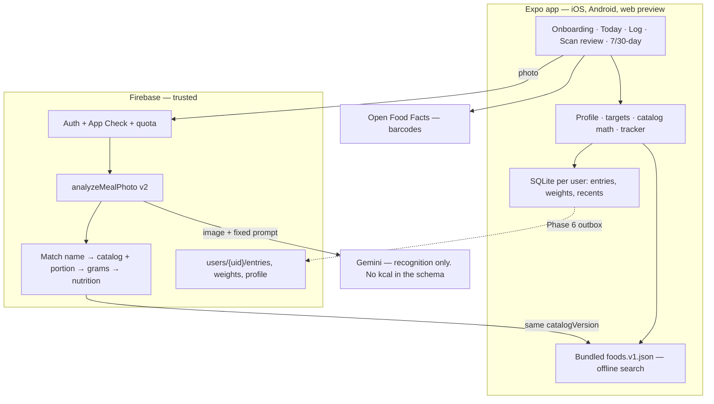

# 360 Fitness — Technical Solution Document, Version 1

| | |
| --- | --- |
| **Branch** | `feature/v1-restructure` |
| **Date** | October 28, 2026 |
| **Status** | Active. Phase 1 (goal + targets) in progress on this branch. |
| **Audience** | Founders, developers, reviewers of the V1 demo |
| **Demo scope** | Two features only: (1) goal-driven calorie and nutrient tracker, (2) AI meal scan grounded in a food catalog |
| **Supersedes** | Flutter “Nourish” architecture picture in `docs/product-blueprint/`; earlier drafts of this file that still described the waist/metric survey as live |

This document is the source of truth for V1. If code and this file disagree, the code is wrong or this file is stale — update one of them in the same change.

---

## 1. Product intent

**Long term:** a HealthifyMe / MyFitnessPal-class product. People log meals (and later workouts) against a personal goal, pay after a trial, and doctors and gym trainers recommend it to clients.

**V1 demo:** prove that the *foundation* is correct, not that every surface exists.

1. **Goal-driven calorie and nutrient tracker.** Onboarding collects the weight-change target in kg plus the body data a daily calorie/macro target needs. Today, 7-day and 30-day views compare eaten vs that target.
2. **AI meal scan grounded in a food catalog.** The model only *recognises* foods and *estimates portions*. Nutrition numbers always come from a versioned catalog and are calculated in our code. The user reviews and corrects before anything is logged.

Everything else (meal prep, voice conversation, label photos as a product, web companion, legacy Flutter, subscriptions, coach sharing) is **frozen**. Not deleted. No new work until the two features above stand on a real data model.

---

## 2. What exists today (audit, 28 Oct 2026)

The repository is a working development foundation, not a store release. Several screens exist. The system underneath them was assembled feature-by-feature without a shared catalog, a tracker data model, or a target that the UI actually uses. That is the “vibe coded” problem: many doors, no building.

### 2.1 Three apps, one product

| Folder | Technology | Status | Problem |
| --- | --- | --- | --- |
| `apps/mobile` | Expo SDK 57, React Native, TypeScript | **The product** | Domain layer is testable; storage and food identity are not |
| `apps/web` | React + Vite | Separate companion | Own diary, own targets, own Google sign-in. Imports mobile via `../../../mobile/src/domain`. **Frozen for V1** |
| `lib/`, `test/`, `pubspec.yaml` | Flutter “Nourish” | Historical, still at repo root | Own parser, own TDEE formula. Confuses every reader |
| `legacy/web-prototype` | Flutter + Drizzle + Supabase | Historical | Third data model |
| `packages/core` | Planned shared TypeScript | **Does not exist** | Server and app cannot share catalog math yet |

### 2.2 Data model (mobile)

- **Storage:** one JSON string in one SQLite row (`apps/mobile/src/data/storage.ts`). Every save rewrites everything. Nothing can be indexed.
- **One workspace per phone, not per user** (backlog U04). Sign-out keeps meals. User B sees user A’s diary.
- **Meals are not synced.** Only profile and meal-prep have optional cloud copies.
- **Food has no identity.** Each `Food` gets a random `local-…` id. Nutrition is stored *for the whole quantity eaten*, not per 100 g (`meals.ts`). “Banana” logged 50 times is 50 unrelated foods.
- **A log entry’s id is the template’s id** (`recordMeal`). Logging the same usual meal twice on one day silently replaces the first entry.
- **One unknown nutrient blanks the whole day.** `sumNutrition` returns `null` for a key if *any* food has that key unknown. Today then shows “— kcal”. Likely contributor to U05/U06.
- **Fiber is not in logged foods.** It exists on barcode products and on computed `Targets`, then is dropped.

### 2.3 Onboarding and targets — Phase 1 started, not finished

**Live survey (code, not older docs):** waist is already gone. Version 2 asks age, **sex**, **height cm**, **current weight kg**, primary goal, **target weight kg**, **weekly pace** (hidden when the goal is maintain), outcome, activity, then a long tail of diet / workouts / notifications / extras.

`calculateTargets` in `apps/mobile/src/domain/targets.ts` is a real Mifflin–St Jeor engine (BMR × activity, pace, safety floor, protein 1.6 g/kg, fat 30%, remainder carbs, fiber 14 g/1000 kcal).

**What is still broken:**

| Item | Evidence |
| --- | --- |
| Review screen imports `<TargetSummary />` | File **does not exist** — typecheck fails |
| Today | Ring counts usual meals checked in, not eaten / calorie target (`today.tsx`) |
| History | 7/30-day bars with no target line |
| Profile tab | Shows “your focus”, not the kcal target |
| Unit tests | `profile.test.ts` still uses the **v1** `metric` / `metricValue` fixture, so tests cannot pass against the live schema. No `targets.test.ts` |
| Firestore rules | Committed `firestore.rules` still describe waist / `profile.version == 1`. Generator already emits v2. Cloud save of a new profile will be **rejected** until rules are regenerated and deployed |
| Questions with no V1 effect | Schedule, diet free-text, meal timing, nutrition priority, workouts, tracking style, notifications, voice, check-in time, grocery budget, wearables. Hints already admit several of these change nothing |

**V1 decision (this document):** keep only questions that compute the goal, or that a doctor/trainer would need (diet, allergies). Drop the rest from the survey. Old extra answers are stripped on load so saved data still opens.

### 2.4 AI meal scan — vision is real, calories are guessed

The photo **does** go to Gemini as image bytes. The model is not “random” in the sense of ignoring the photo. It *is* guessing the numbers.

```text
photo → resize JPEG ≤1600px → Gemini vision (callable or on-device AI Logic)
      → JSON { name, quantity, unit, nutrition{kcal, protein, carbs, fat} }
      → user review → local SQLite diary
```

- Prompt (`functions/src/mealPhotoAnalysis.js`) **requires** the model to emit kcal/macros from “typical reference values”. There is no tool use. USDA is **not** called on this path.
- USDA exists only on the **web text-meal** path (`parseMealCallable`), first search hit, cups = 240 g, only if the model returned empty calories.
- A second client route (Firebase AI Logic, `gemini-3.8-flash`, default temperature 1.0) **skips the server quota**.
- No numeric confidence. No catalog id. No portion table. Linear 0.5× / 1× / 1.5× of whatever the model invented.
- **It does not work offline / unconfigured.** Without `EXPO_PUBLIC_LABEL_AI_ENABLED` or `EXPO_PUBLIC_MEAL_PHOTO_AI_LOGIC` plus a Gemini key, Analyze is disabled. Numbers seen in an unconfigured checkout did not come from this pipeline.

There is **no food catalog**. No `packages/core/catalog/foods.v1.json`. Barcode hits Open Food Facts and is discarded after a 10-minute in-memory cache.

### 2.5 Keep these design choices

- AI proposes; the user confirms. Nothing auto-logs.
- Unknown is never stored as zero. Missing days are not zero-calorie days.
- Logged meals are snapshots. Editing a template does not rewrite history.
- Server-side keys, App Check, per-user quotas on the callable path.
- Firestore rules generated from the onboarding schema.
- Barcode lookup via Open Food Facts with check-digit validation.
- Domain layer is unit-testable.

---

## 3. Gaps, ranked

| # | Severity | Gap | Consequence | Phase |
| --- | --- | --- | --- | --- |
| G1 | Critical | No food catalog | No search, recents, trustworthy numbers, or learning | 3 |
| G2 | Critical | AI invents nutrition | Published photo-AI apps underestimate meal energy ~33% (§10). No correction path into a database | 5 |
| G3 | Critical | Target engine not wired to the tracker | A calorie tracker that cannot say “on track” | 1 |
| G4 | High | Tracker model (entry id = template id, whole-day null, no per-100 g) | Lost logs, “—” totals, no rescaling | 2 |
| G5 | High | Single JSON blob, one workspace per device | Data leaks between accounts. Cannot scale or sync | 2, 6 |
| G6 | High | Three front ends, no shared package | Drift; every change made twice | 0 |
| G7 | High | Two AI routes, copied prompts, one bypasses quota | Cost, abuse, different answers | 5 |
| G8 | Medium | Meals not synced; legacy `users/{uid}/**` is wide open | Lost history on reinstall | 6 |
| G9 | Medium | No entitlement / trial / subscription | Cannot sell the product | 7 |
| G10 | Medium | Docs describe intentions as facts; “Nourish” naming | Hard to know what is true | 0 |
| G11 | Low | Fiber missing; Today’s ring counts meals not calories | Main screen measures the wrong thing | 1, 2, 4 |

---

## 4. How real apps solve meal scan and tracking

This is not a branding comparison. It is the technical pattern V1 copies.

### 4.1 The pattern every serious app uses

```text
  Search, barcode, photo, voice, recents
                 │
                 ▼
        ┌─────────────────┐
        │  FOOD CATALOG    │  per 100 g + household portions
        │  (versioned)     │  roti = 40 g, katori dal = 150 g
        └────────┬────────┘
                 │  foodId + grams
                 ▼
        nutrition = per100g × grams / 100     ← calculated in OUR code
                 │
                 ▼
        user confirms → diary snapshot
```

**The vision model never supplies the calorie number the user sees.**

### 4.2 MyFitnessPal / Passio

Meal Scan identifies items in a photo, then **matches them to MFP’s verified database**. Passio’s own docs are explicit:

- AI returns `recognisedName`, `portionSize`, `weightGrams` — display / internal mapping only.
- Nutrition comes from `nutritionPreview` / `refCode` on the **database item**.
- *“You do not need to use [the AI’s raw weight] directly… always use the resolved foodDataInfo.”*
- Formula: `N = nutrientAmount × (portionWeight / 100) × quantity` (nutrients stored per 100 g).
- 2025: dietitian-curated “Best Match” rows; users can add missed items by search.

### 4.3 HealthifyMe Snap (the closest product analogue for India)

Hybrid pipeline, not “one Gemini call”:

1. **On-device** small model: is this a food photo? Non-food never leaves the phone.
2. **Server ensemble** (proprietary CNNs + GPT-4 Vision): identify dishes, including thali components.
3. **Embeddings:** cosine similarity between the model’s food name and Healthify’s catalog names. GPT has its own vocabulary; the catalog has another. Matching is a separate system.
4. Heuristics + user history to rank candidates.
5. Human review loop and user corrections train the next version.
6. ~150,000 Indian cuisine items; user still reviews in the app.

This is why “ask Gemini for calories” will not scale to the doctor/trainer pitch. Indian mixed plates are a matching problem against a **curated Indian catalog**, not a generation problem.

### 4.4 Research systems that beat consumer photo-AI

- **Nutrition5k** (Google): RGB-D + **USDA lookup**. Depth/volume cut calorie error from ~26% to ~16.5%.
- **DietAI24** (2025): GPT-4 Turbo **retrieves** USDA FNDDS (5,624 foods, 23,000 portions). 76–83% lower calorie error than commercial photo apps on ASA24. Same idea: identify → map → lookup, never generate macros.
- Independent 2026 feeding-study: MyFitnessPal, Lose It, Cal AI, Appediet all **underestimated** controlled meals by ~33%, mostly by missing fat (oil, ghee, sauces). Portion and hidden fat are the hard parts — which is why a household portion table (katori, roti, teaspoon of oil) matters more than a bigger model.

### 4.5 What we will not do in V1

- License Passio / Edamam / Nutritionix for the demo (evaluate after).
- Ship IFCT 2017 or INDB before written permission (licences forbid silent reuse).
- On-device food-vs-not-food classifier (HealthifyMe scale). Server callable + user-initiated photo is enough for the demo.
- LiDAR / depth. Single 2D photo + catalog portions + user correction.
- Auto-log from camera roll.

---

## 5. Target architecture (V1)



### 5.1 Decisions

| Decision | Choice | Why |
| --- | --- | --- |
| Client | One Expo app | Already the most complete. RN Web is the doctor/trainer demo link |
| `apps/web` | Frozen | Its features are rebuilt properly in mobile |
| Flutter / legacy | Leave in tree for V1 demo; remove after (Phase 0b) | Deleting now is noise; it must not be imported |
| Shared math | `packages/core` once catalog exists (Phase 3). Until then, domain stays in mobile and the server **imports the same JSON** | Don’t block the demo on a monorepo refactor |
| Backend | Keep Firebase | Fine at scale if each diary event is its own document |
| AI route | **Server callable only.** Remove AI Logic | One prompt, one quota, keys stay server-side |
| Search | Bundled catalog, in-memory / SQLite FTS | Instant, offline, enough for 150–250 foods |
| Region | India first, global staples included | USDA alone cannot represent roti / dal / sabzi |
| Calories on screen | Always `catalog.per100g × grams / 100` | The model cannot invent a number we display |

---

## 6. Feature 1 — Goal-driven calorie and nutrient tracker

### 6.1 Onboarding (V1 question set)

Waist is already removed. V1 also drops questions that do not compute the goal and are not needed by a doctor/trainer reviewing a client.

| Section | Question | Required | Why it stays |
| --- | --- | --- | --- |
| About you | Age range | yes | BMR (range midpoint) |
| About you | Sex for calorie estimates | yes | BMR. “Prefer not to say” averages the two constants |
| About you | Height (cm) | yes | BMR, BMI |
| About you | Current weight (kg) | yes | BMR, starting point |
| Your goals | Primary goal | yes | Product intent |
| Your goals | Target weight (kg) | yes | Lose / gain / maintain |
| Your goals | Weekly pace | yes, hidden if maintain | Daily deficit or surplus |
| Your goals | Desired outcome | yes | The user should be able to *state* the goal |
| Daily life | Activity level | yes | TDEE multiplier |
| Food | Diet preference | yes | Catalog filters; doctors/trainers |
| Food | Allergies | yes | Safety labelling later; never treated as certified |

**Removed from the survey (answers stripped on load):** schedule, diet free-text, avoided foods, meal timing, nutrition priority, workouts, workout frequency, tracking style, notifications, voice, check-in time, grocery budget, wearables.

**Migration:** v1 weight (kg/lb) → `currentWeightKg`. Waist is dropped, never relabelled. Incomplete profiles reopen as a draft at the first new question. Unknown keys from retired questions are stripped so old JSON still loads.

### 6.2 Target engine

Pure function `calculateTargets(answers) → Targets | null`. Not persisted — derived whenever the profile is read, so formula changes do not require a data migration.

| Step | Rule |
| --- | --- |
| BMR | Mifflin–St Jeor: `10×kg + 6.25×cm − 5×age + s` (M +5, F −161, unspecified −78) |
| Maintenance | BMR × 1.2 / 1.375 / 1.55 / 1.725 / 1.375 (varies) |
| Direction | \|Δkg\| ≤ 0.5 → maintain; else lose or gain |
| Pace cap | Loss ≤ 1% body weight/week; gain ≤ 0.5 kg/week |
| Daily adj. | `± pace × 7700 / 7` (labelled an estimate; the 7700 kcal/kg rule is approximate) |
| Floor | 1200 F / 1500 M / 1350 unspecified. Recalculate real pace if the floor binds |
| Under 18 | Maintenance only + doctor note |
| Protein | 1.6 g/kg (target weight if losing, else current) |
| Fat | 30% of kcal |
| Carbs | Remainder |
| Fiber | 14 g / 1000 kcal |

Shown as **estimates, not medical advice**, everywhere a number appears. A doctor-adjustable target is Phase 7.

### 6.3 Tracker data model v2 (Phase 2 — after targets are visible)

```text
LogEntry                   one food eaten (a meal is a group)
  id          uuid         never reused
  mealId      uuid         groups items logged together
  date        YYYY-MM-DD
  slot        Breakfast | Lunch | Dinner | Snack
  foodId?     catalog id   null for custom / unmatched
  name        snapshot
  amount, unit, grams
  nutrition   snapshot { kcal, protein, carbs, fat, fiber }  number | null
  source      catalog | barcode | label | photo | manual
  scanId?

WeightLog     { date, kg, loggedAt }
DaySummary    derived, never the source of truth
```

**Totals rule:** sum known values. Report how many items are missing a number. Show the day as *partial*, never blank.

Until Phase 2 lands, Today/History still use the current `Entry` shape. They **will** show eaten vs target using `dailyNutrition` as it exists, including the whole-day-null behaviour. That bug is G4, not G3.

### 6.4 Views

| View | V1 must show |
| --- | --- |
| Onboarding review | Target card: kcal, macros, direction, weeks to goal, estimate disclaimer |
| **Today** | Calorie ring eaten / target and remaining. Protein, carbs, fat vs target. Log / Scan. Usual meals still available |
| **7 days** | Daily bars against a target line. Average. Days logged. Days within ±10% of target |
| **30 days** | Same. Weight trend is Phase 2 (`WeightLog`) |
| Profile | Current target and a link to edit the survey |

---

## 7. Feature 2 — AI meal scan grounded in the catalog

Do not implement this until Phase 3 (catalog) exists. A “smarter prompt” without a catalog is the current design, slightly better worded.

### 7.1 Pipeline

```mermaid
sequenceDiagram
  participant U as User
  participant A as App
  participant F as analyzeMealPhoto v2
  participant M as Vision model
  participant R as Resolver + catalog
  U->>A: Take/choose photo (optional hint: "fried in ghee")
  A->>A: Resize ≤1024 px JPEG
  A->>F: image, hint, catalogVersion
  F->>M: schema: items[] {label, aliases, preparation, count, householdUnit, estimatedGrams, confidence}
  Note over M: No nutrition fields exist in the schema
  M-->>F: recognition only
  F->>R: alias / normalised-name match; later embeddings
  R-->>F: top-3 candidates, grams from portion table, nutrition = per100g × g / 100
  F-->>A: draft {candidates, foodId, grams, nutrition, confidence, matched|unmatched}
  A->>U: Swap match, change katori/piece/g, add missed item via search
  U->>A: Confirm
  A->>A: Write log entries (source=photo, scanId), update recents
  A-->>F: consented correction: predicted vs final food and grams
```

### 7.2 Rules

1. **The model’s JSON schema has no kcal, protein, carbs, or fat fields.** If a model emits them anyway, the server discards them.
2. **Match** to the catalog by normalised name and aliases (roti / chapati / phulka). Score ≥ threshold → auto-select. Else the user picks. No match → unmatched; user searches or enters a custom food. An `ai_estimate` fallback is a flagged, labelled last resort, never mixed silently with catalog values.
3. **Portions** come from the catalog table (`1 medium roti = 40 g`). The model’s count × unit is converted through that table. Raw gram estimates are used only when the unit is unknown, and are clamped to a plausible range for that food.
4. **Same `catalogVersion`** on server and app, so review numbers equal logged numbers.
5. **One server route.** Delete the AI Logic path. Image ≤1024 px. No photo storage by default.
6. **Eval set** of ≥50 weighed Indian and global meals in `functions/test/fixtures/scan-eval`. Report top-1 match, portion error, calorie error before any prompt or model change.

### 7.3 Catalog schema

```text
Food
  id              stable slug  e.g. in.roti.wheat
  name, aliases[] English + Hindi / regional
  category, cuisine, tags[]
  per100g         { kcal, protein, carbs, fat, fiber }
  portions[]      { label: "1 medium roti", grams: 40, default? }
  source          usda | curated_recipe | off
  sourceRef
  verified        boolean
  catalogVersion
```

| Source | Licence | V1 |
| --- | --- | --- |
| USDA FoodData Central Foundation + SR Legacy | CC0 | Yes — ingredients and global staples |
| Our recipe calculations (dal, sabzi, roti, poha…) from USDA ingredients + standard recipes | Ours | Yes — marked `curated_recipe`, unverified until a nutritionist reviews |
| IFCT 2017 (ICMR-NIN) | No electronic product use without written permission | Apply; do not ship |
| INDB (Jaacks Lab) | No licence in the repo | Ask; do not ship |
| Open Food Facts | ODbL | Barcodes, with attribution, as today |
| Passio / Edamam / FatSecret / Nutritionix | Paid | After the demo |

V1 seed: **150–250 foods** covering common Indian home meals, breakfasts, snacks and global staples. Tests: macros reconstruct kcal within tolerance; every food has a default portion.

---

## 8. Scale, revenue, doctor/trainer channel

Designed now so V1 does not paint us into a corner. Built after the demo.

- **Entitlements:** server-side `free` vs `premium` (Firebase custom claims + RevenueCat or equivalent). Scan quotas per tier (example: 3/day free, fair-use premium). Trial = time-boxed premium claim.
- **Coach / doctor sharing:** data stays under `users/{uid}`. A `shares/{shareId}` grant gives a named coach *read* access for a window. Coach view is a role, not a second app.
- **Privacy:** DPDP Act 2023 — explicit consent, purpose limitation, deletion, export. No photo retention by default.
- **Scale:** one Firestore document per log entry plus derived day summaries. Catalog search moves off-device when the file no longer fits.

---

## 9. Build order

Each phase is one or more focused PRs into `feature/v1-restructure`. A phase is done only when its acceptance check passes. **Do not start Phase 5 (AI scan v2) before Phase 3 (catalog).** That is how the current app was vibe-coded.

| Phase | Work | Acceptance | Demo |
| --- | --- | --- | --- |
| **0. Freeze, don’t churn** | Freeze `apps/web`. Do not import Flutter. Add this document as the architecture source. Leave `packages/core` until catalog work needs it | Mobile and functions checks can run. No new web/Flutter features | Hygiene |
| **1. Goal and targets** | Trim survey to §6.1. Migration + strip retired keys. `calculateTargets` + tests. `TargetSummary`. Wire Today, History, Profile. Regenerate Firestore rules | New user finishes onboarding and sees a daily kcal/macro target on review **and** Today. Old data opens. `npm run check` and `rules:check` pass | **Now** |
| **2. Tracker model v2** | Unique entry ids, partial totals, fiber, delete entry, per-user storage. Weight log | Same meal twice creates two entries. One unknown food doesn’t blank the day | Yes |
| **3. Food catalog v1** | Schema + 150–250 seed foods with portions. Search + aliases. Recents. Log-by-search + portion picker | “2 roti + 1 katori dal” in under 5 taps, numbers from the catalog | Yes |
| **4. Tracker UI** | Ring and macro bars vs target (if not already from Phase 1). 7/30-day vs target. Weight trend | Today / 7 / 30 numbers agree with entries | Yes |
| **5. AI scan v2** | Recognition-only schema. Server resolver. Review UI with candidate swap. Remove AI Logic. Eval fixtures | Photo → review → confirm logs **catalog** numbers. Eval report checked in. Works via loopback `functions` dev server | Yes |
| 6. Cloud sync | Outbox, `users/{uid}/entries`, strict rules, account deletion | Two devices, no duplicates, delete is complete | After demo |
| 7. Revenue + coach | Entitlements, paywall, share grants | Trial → premium. Coach sees only shared clients | After demo |

**Demo path:** phases 1–5. Scan can run against the local loopback server; production deploy is not required for the first showing.

---

## 10. Risks

| Item | Risk | Default |
| --- | --- | --- |
| Indian food licences | Shipping IFCT/INDB without permission | USDA + our recipes, labelled unverified |
| Photo calorie accuracy | Even catalog-grounded apps miss oil/ghee; studies show ~33% underestimate when the model is the database | User correction + portion table + eval set. Never claim medical precision |
| JSON-blob migration (Phase 2) | Highest data-loss risk | Back up the old row; keep a rollback parse |
| Medical claims | Targets are estimates | Disclaimer on every target surface |
| Gemini vs other VLMs | Large model-to-model error | Measure with the golden set before changing models |
| `packages/core` timing | Early monorepo move delays the demo | Create it when the catalog JSON needs to be shared with functions |

---

## 11. References

- MyFitnessPal Meal Scan and database: [support](https://support.myfitnesspal.com/hc/en-us/articles/360045761612-How-to-use-the-Meal-Scanner), [how the food database works](https://blog.myfitnesspal.com/how-food-database-works/), [2024 Meal Scan](https://blog.myfitnesspal.com/myfitnesspal-2024-summer-release/), [2025 Best Match](https://blog.myfitnesspal.com/winter-release/)
- Passio (MFP’s recognition vendor): [image recognition](https://passio.gitbook.io/nutrition-ai/mobile-sdks/use-cases/food-recognition), [do not use raw AI weight](https://passio.gitbook.io/nutrition-ai/fundamentals/api-sdk-interoperability/nutrition-data-model-mapping)
- HealthifyMe Snap: [OpenAI case study (embeddings + GPT-4V)](https://openai.com/index/healthify/), [TechCrunch](https://techcrunch.com/2023/09/21/khosla-backed-healthifyme-introduces-ai-powered-image-recognition-for-indian-food/), [pipeline write-up](https://www.linkedin.com/pulse/magic-part-2-snap-abhijit-khasnis-sp6oc)
- SnapCalorie / Nutrition5k: [Nutrition5k paper](https://arxiv.org/html/2103.03375v2) (USDA + optional depth)
- DietAI24 (LLM + USDA retrieval, not generation): [CDN 2025](https://doi.org/10.1016/j.cdnut.2025.106906)
- Accuracy: [four apps, ~33% underestimate](https://cdn.nutrition.org/article/S2475-2991(26)01103-0/fulltext); [independent image-based MAPE ~19%](https://dietaryassessmentinitiative.org/publications/image-based-systematic-review-2025/)
- Data: [USDA FDC (CC0)](https://fdc.nal.usda.gov/download-datasets/), [IFCT 2017 terms](https://www.nin.res.in/ebooks/IFCT2017.pdf), [INDB](https://github.com/lindsayjaacks/Indian-Nutrient-Databank-INDB-)
- Targets: [NHLBI practical guide](https://www.nhlbi.nih.gov/files/docs/guidelines/prctgd_c.pdf); limits of 7700 kcal/kg: [Hall et al.](https://pmc.ncbi.nlm.nih.gov/articles/PMC4035446/)
- Internal: [`docs/food-directory-research.md`](../food-directory-research.md), [`V1-FEATURE-REPORT.md`](V1-FEATURE-REPORT.md)
