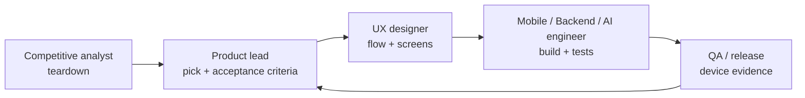

# 360 Fitness — working roles

Created October 19, 2026. This is how the work is split, not a staffing plan. One person (or one agent session) can hold several roles, but each piece of work has exactly one **owner role** and names the **reviewer role** who signs it off.

## Roles

| Role | Owns | Produces | Does not do |
| --- | --- | --- | --- |
| **Product lead** | What we build and in what order | Priorities in [USER-FEEDBACK-BACKLOG.md](../USER-FEEDBACK-BACKLOG.md), acceptance criteria, scope cuts | Write implementation code |
| **Competitive analyst** | Understanding how other apps (MyFitnessPal, Cal AI, etc.) behave | Clean-room teardowns in [`docs/teardown/`](../teardown/) | Decompile apps or copy code, text, images or data (see rules below) |
| **UX designer** | Screens, flows and copy | Flow diagrams, screen specs, [mobile-design.md](../mobile-design.md) updates | Change domain rules |
| **Mobile engineer** | `apps/mobile` — screens, state, local storage | Expo/React Native code with tests | Change Firestore rules or functions without a backend review |
| **Backend engineer** | `functions/`, `firestore.rules`, external data sources (USDA, Open Food Facts) | Callable functions, rules, rule tests, data adapters | Ship client UI |
| **AI engineer** | Gemini prompts, response validation, AI quality | Prompt changes with held-out examples and accuracy notes | Let AI output skip user review |
| **QA / release** | Proving things work on real phones | Device test reports, release checklists, EAS builds | Mark a feature done without device evidence |

## How a feature moves

1. **Teardown** — the analyst documents how a competitor feature behaves and what users get from it.
2. **Decision** — the product lead turns it into a backlog item (U-ID) with acceptance criteria, or rejects it.
3. **Design** — UX writes our own flow. It must not reproduce the competitor's layout, wording or assets.
4. **Build** — one GitHub PR per coherent change, referencing the U-ID.
5. **Verify** — QA confirms on iOS and Android builds before the item is called done.

## Clean-room rules for competitive analysis

We study competitors to understand *what problem a feature solves and how it behaves*, then design our own solution.

**Allowed sources**

- Public help centers, marketing pages, app store listings, release notes and public reviews.
- Using the competitor's app normally on our own account and noting what we see (screen flow, number of taps, what's free vs. paid).
- Open data we are licensed to use: USDA FoodData Central (public domain), Open Food Facts (ODbL — attribution and share-alike apply to the database).

**Not allowed**

- Decompiling, disassembling or patching a competitor's app or binary (MyFitnessPal's terms prohibit this), including with REA or similar tools.
- Calling a competitor's private APIs, scraping their food database, or capturing their traffic to reuse their endpoints.
- Copying their code, UI text, icons, screenshots or food entries into our repo or app.

REA (`morluto/rea`) is fine to use on **our own** builds — for example, checking what our shipped JS bundle exposes, or auditing native dependencies — and on open-source apps whose licenses allow it.

Every teardown records its sources so a reviewer can confirm it stayed within these rules.
