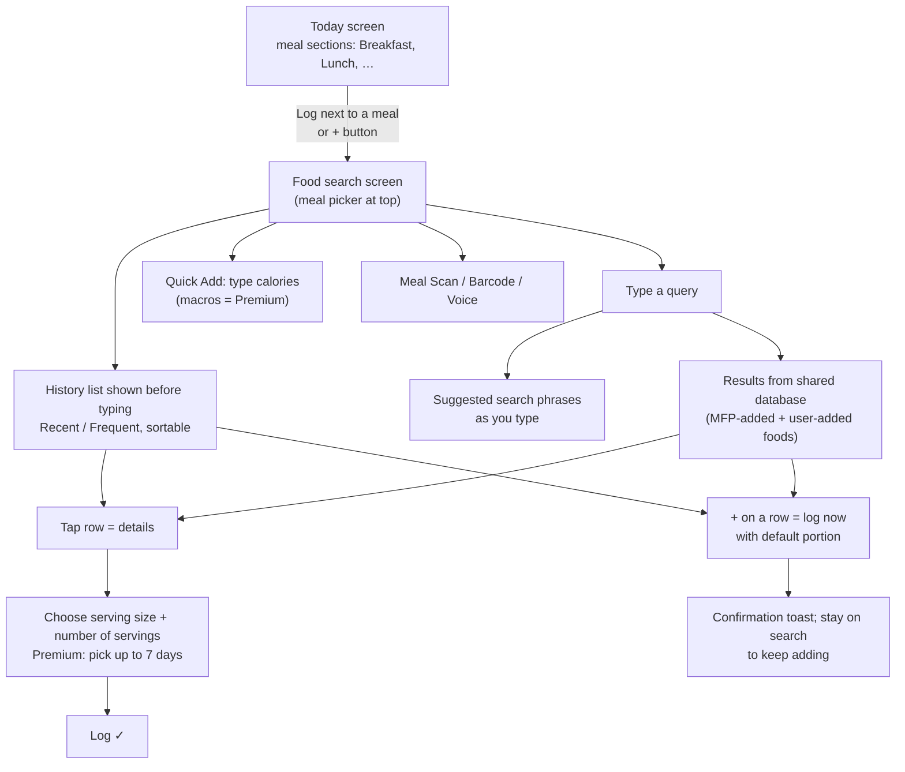

# Teardown: MyFitnessPal food logging and search

**Owner:** Competitive analyst · **Reviewer:** Product lead · **Date:** October 19, 2026
**Method:** clean-room, public sources only (see [ROLES.md](../team/ROLES.md#clean-room-rules-for-competitive-analysis)). No app decompiling, no private API calls, no copied text or assets. Not yet checked hands-on in the app — a short in-app walkthrough on a personal account is listed under next steps.

## Summary

MyFitnessPal (MFP) makes logging fast in three ways: **(1)** a search screen that opens on your own history, so most logs never need typing; **(2)** one-tap logging from search results with a default portion; **(3)** several shortcuts for repeat eating — saved meals, logging to several days at once, and calorie-only quick entries.

360 Fitness has strong inputs (photo, barcode, label, usual meals) and a careful review step, but **no food search at all**. To log "a banana" you have to build a meal manually and type its nutrition yourself. Food search is the biggest gap.

## How MFP's flow works

### Feature notes

| # | MFP behavior | Source |
| --- | --- | --- |
| F1 | Every meal section on Today has its own **Log** button; a global **+** also opens search. The target meal can be changed at the top of the search screen. | [Log food](https://support.myfitnesspal.com/hc/en-us/articles/360032274592), [Quick Log](https://support.myfitnesspal.com/hc/en-us/articles/360032622491) |
| F2 | Search opens on **history** (Recently Logged). Users can sort it by most recent, most frequent, A–Z or Z–A, and the choice is remembered. | [Sort food lists](https://support.myfitnesspal.com/hc/en-us/articles/360032621811) |
| F3 | **Frequent** fills itself from logging counts. Users can hide items (swipe on iOS, long-press on Android); hiding doesn't touch the database. | [Recent & Frequent](https://support.myfitnesspal.com/hc/en-us/articles/360032622071) |
| F4 | **Quick Log**: a **+** on every result logs it at its current portion, shows a confirmation, and keeps you on the search screen to add more. | [Quick Log](https://support.myfitnesspal.com/hc/en-us/articles/360032622491) |
| F5 | **Suggested searches** complete the phrase as you type. Tapping one runs the search; it never logs anything. Only for general food search. | [Suggested Searches](https://support.myfitnesspal.com/hc/en-us/articles/12338510991117) |
| F6 | The database mixes foods added by MFP and by users. User-added foods often have only one serving size. Users can report wrong entries. | [Food data](https://support.myfitnesspal.com/hc/en-us/articles/360032271252), [Serving sizes](https://support.myfitnesspal.com/hc/en-us/articles/360032272852), [Report](https://support.myfitnesspal.com/hc/en-us/articles/360032274312) |
| F7 | Portion = **serving size × number of servings** (decimals; fractions in some versions). Units are limited to what the food entry defines. | [Serving sizes](https://support.myfitnesspal.com/hc/en-us/articles/360032272852) |
| F8 | **Quick Add**: enter calories without searching (macros need Premium). Users often label these with diary notes. | [Quick Add](https://support.myfitnesspal.com/hc/en-us/articles/360032621971) |
| F9 | **Multi-day logging** (Premium): log one food to up to 7 days. Each day becomes a separate entry; there's no single undo. | [Multi-day](https://support.myfitnesspal.com/hc/en-us/articles/33535658002061) |
| F10 | **Saved meals, recipes and My Foods** for repeat combinations and foods missing from the database. | [Saved meals](https://support.myfitnesspal.com/hc/en-us/articles/360032625331), [My Foods](https://support.myfitnesspal.com/hc/en-us/articles/360032623471) |
| F11 | Other ways in from the same screen: Meal Scan, barcode, voice (with a "Try again" before logging). | [Today tab](https://support.myfitnesspal.com/hc/en-us/articles/39985611667341), [Voice](https://support.myfitnesspal.com/hc/en-us/articles/30332897072269) |

### Weak spots we can do better on

- **Crowd-sourced data quality.** User-added entries vary and often have one serving size. MFP needs a "report incorrect food" flow because of this.
- **Silent logging.** Quick Log saves with whatever the default portion is. That's fast, but the portion may be wrong.
- **Paywalled basics.** Macros in Quick Add and multi-day logging are Premium.
- **Undo.** Multi-day entries have to be deleted one day at a time.
- **History bugs.** Public user reports describe Recent/Frequent lists not updating, and the MFP team acknowledged fixes in progress ([Reddit thread](https://www.reddit.com/r/Myfitnesspal/comments/1nm9eou/anyone_else_have_their_searchpreviously_used/)).

## Where 360 Fitness stands today

Based on `apps/mobile/src` (October 19):

| MFP feature | 360 Fitness today | Gap |
| --- | --- | --- |
| F1 Log per meal | [today.tsx](../../apps/mobile/src/app/(tabs)/today.tsx) → [add.tsx](../../apps/mobile/src/app/add.tsx) menu of input methods; meal slot chosen in the editor | Small — entry exists, but slot isn't carried from Today |
| F2/F3 History-first list | Usual meals (`templates`) on Today; no per-food history | **Medium** — we track whole meals, not individual foods |
| F4 One-tap log | Usual meals can be checked in; single foods can't | **Medium** |
| F5/F6 Food search + database | **None.** USDA lookup exists only in the backend to fill gaps in AI estimates ([usda.js](../../functions/src/usda.js), `pageSize=1`). Open Food Facts is used only by barcode. | **Large — core gap** |
| F7 Serving size × count | `quantity` + free-text `unit`; [scaleFood](../../apps/mobile/src/domain/meals.ts) scales linearly from the original quantity | Medium — no list of serving options per food |
| F8 Quick Add | Manual meal editor can do it, but it's several steps | Small |
| F9 Multi-day | Not present. Prep plans cover batch cooking separately | Low priority |
| F10 Saved meals / custom foods | Usual meals = saved meals. No reusable custom *foods* | Medium |
| F11 Other inputs | Photo, barcode, label, import — with mandatory review | **We're ahead** |

Things to keep: unknown nutrition stays `null` instead of 0, nothing is logged without explicit confirmation, and retries can't duplicate an entry ([recordMeal](../../apps/mobile/src/domain/meals.ts)). These are real advantages over MFP's silent Quick Log.

## Proposed build — "Search & log" (new backlog item U14)

Our own design, built on open data and our existing review-first principle.

**User story.** On Today I tap *Log* on Lunch. The search screen opens on foods I've logged before. I type "greek yog", tap a suggestion, see results labelled by source, tap **+** on one, and it's added to a lunch draft at its default serving. I can keep adding foods and then confirm the meal once. Nothing is recorded until I confirm.

How this differs from MFP: **+** adds to a draft basket rather than logging straight away. Logging stays fast (one confirm per meal, not per food) and keeps our review step.

### Slices (one PR each)

1. **Food search adapter (backend engineer).** A callable `searchFoods(query)` that queries USDA FoodData Central (Foundation, SR Legacy and Branded) and Open Food Facts search, maps results to a common `FoodCandidate {id, name, brand?, source, servings[], per100g}`, and caches responses. The USDA key stays server-side, and calls get the same Auth/App Check/usage checks as other callables. Tests use recorded fixtures.
   *Built October 19:* `searchFoodsCallable` in [foodSearch.js](../../functions/src/foodSearch.js). Open Food Facts uses the search-a-licious API, because the legacy `cgi/search.pl` endpoint returned a maintenance page during testing. Its own quota is `searchUsage/{uid}`: 30 searches a minute and 600 a day.
2. **Serving model (mobile + backend).** Add `servings: {label, grams}[]` to candidates. FDC search results come back with **no portion weights** (e.g. "Bananas, raw" has an empty `foodMeasures`), and search-a-licious returns no serving fields, so household portions like "1 medium" need a details call (`/fdc/v1/food/{id}`) when a result is opened. Scale nutrition from grams per 100 g. Keep free-text units for manual foods. Migrate `Food` without breaking stored v1 records.
3. **Food history (mobile).** Build Recent/Frequent from confirmed `entries` (count + last used per normalized food). No new storage needed, and hiding an item is a local preference. Sort options with a remembered choice.
4. **Search screen + basket (UX + mobile).** New `/search?slot=Lunch&date=…` route: history before typing, debounced search, source badges ("USDA", "Open Food Facts", "Mine"), **+** to add to the draft, tap to choose serving and count, then a Review → Confirm handoff to the existing meal editor.
5. **Today entry points (mobile).** A *Log* action on each meal slot opens search with the slot preset. The add menu keeps photo, barcode and label as alternatives.
6. **Quick entry (mobile).** "Just the numbers": calories plus optional macros, all free.

**Acceptance criteria**

- Searching "banana" returns at least one USDA result with a gram-based serving; logging 1 medium banana gives values that match FDC within rounding.
- History shows a food after it has been confirmed once, not after it has only been drafted or skipped.
- Adding foods with **+** never creates an entry until the meal is confirmed; going back discards the draft.
- With no network, history and manual entry still work and search shows a clear offline message.
- Missing nutrients stay unknown (—) in search results, the basket and history totals.

### Open questions for the product lead

1. Do we want user-contributed foods in a shared database (MFP's model), or only personal custom foods plus open data? *Recommendation: personal only for v1 — it avoids data-quality and moderation work.*
2. Branded foods: USDA Branded is US-only. What's the launch market?
3. Should Quick Log (instant, no basket) exist for single snacks? *Recommendation: no for v1. Revisit after usability sessions.*

## Next steps

- [ ] Product lead: accept/edit U14 and add it to [USER-FEEDBACK-BACKLOG.md](../USER-FEEDBACK-BACKLOG.md).
- [ ] Competitive analyst: 15-minute hands-on walkthrough of MFP's free tier on a personal account. Count taps to log a banana, a repeat breakfast and a restaurant meal. Write notes only — no screenshots in the repo.
- [ ] Backend engineer: start slice 1 (search adapter). Get a USDA FDC API key into Functions secrets.
