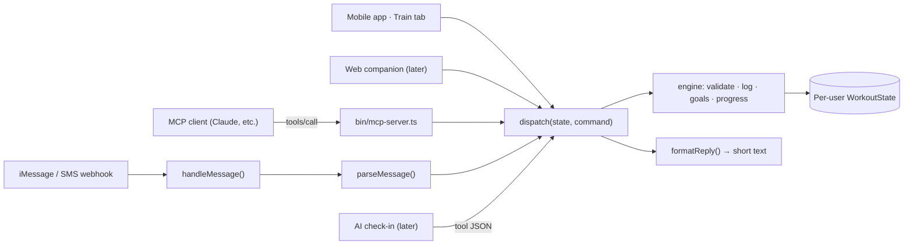

# PRD — Workout goals and tracking

| | |
| --- | --- |
| **Status** | Draft for review · November 18, 2026 |
| **Tracker rows** | `Project Plan r13` (Workout criteria), `AI Notification r5` (workout step), `Project Plan r11/r14` (unified progress, progress vs goal) |
| **V1 report items closed** | 2.1 Workout criteria (was NO-GO) · partial 3.2 and 3.3 · foundation for 4.6 |
| **Code** | `packages/workout-core/` (engine, parser, MCP server, messaging adapter) · `apps/mobile/src/app/(tabs)/train.tsx` |

## 1. Problem

The app tracks food only. Onboarding asks about workouts (`workouts`, `workoutFrequency`), but nothing records what someone actually did or compares it to a goal. The tracker's "Workout criteria" row (type, duration, intensity, completion) is NO-GO in the V1 report.

Logging also has to be easy wherever the person is. The roadmap puts a daily check-in in chat (iMessage) and AI assistants (MCP) next to the app, so the rules can't live only inside one screen.

## 2. Goals and non-goals

**Goals**

1. A person can set a **weekly workout goal** and see progress toward it at a glance.
2. A person can **log a workout in under 10 seconds**: a typed phrase ("ran 5k in 28 min") or a short form.
3. **One engine, many surfaces.** App, web, MCP and messaging all call the same commands and get identical validation, de-duplication and progress maths.
4. Retries never double-count. Bad input never corrupts saved data.

**Non-goals (this release)**

- AI-generated workout plans and coaching (tracker module "AI Workout / Training" is still Discovery).
- Wearable / HealthKit / Health Connect import (U11). The schema reserves `source: "wearable"` for it.
- Calories-burned estimates. These are easy to get wrong, so they stay out until there's a validated method.
- Workout camera / form checking (Future).

## 3. Users and key stories

| # | As a… | I want to… | So that… | Acceptance |
| --- | --- | --- | --- | --- |
| S1 | Person who just finished onboarding | pick a weekly goal from 3 presets or type my own | I have something to aim for | One tap creates the goal; it shows a 0/N bar for this week |
| S2 | Person after a run | type "ran 5k in 28 min" | logging takes seconds | The app shows a review line, then Confirm saves one session and updates the bar |
| S3 | Person who prefers taps | choose type, minutes, intensity and optional km | I can log without typing a sentence | "Log workout" saves and shows progress in the confirmation notice |
| S4 | Person who missed a day | say "skipped run, knee sore" | the reason is kept (tracker AI Notification r7) | Stored as `status: skipped` with `skipReason`; it does not count toward goals |
| S5 | Person in iMessage | text "status" | I see my week without opening the app | Reply lists totals, each goal's progress and the streak |
| S6 | Person using Claude/another assistant | say "log a 45 minute yoga session" | the assistant records it for me | MCP `log_workout` tool returns structured result and human text |
| S7 | Anyone | undo a mistake | wrong data doesn't stick | "undo" removes the last workout **from the same surface only**; the app's trash button deletes any session |

## 4. Functional requirements

### 4.1 Data model (`packages/workout-core/src/types.ts`)

**WorkoutSession**: `id`, `date` (local YYYY-MM-DD), `type` (run · walk · cycle · swim · strength · yoga · hiit · sport · other), `durationMin` (0–1440), `intensity` (easy · moderate · hard), optional `distanceKm`, `title`, `note`, `exercises[{name, sets[{reps, loadKg|null, done}]}]`, `status` (completed · planned · skipped), optional `skipReason`, `source` (app · web · mcp · message · wearable), optional `idempotencyKey`, `createdAt`, `updatedAt`.

**WorkoutGoal**: `id`, `title` (auto-generated, e.g. "3 workouts a week"), `metric` (sessions · minutes · distanceKm · activeDays), weekly `target`, optional `types[]` scope, `status` (active · archived).

**WorkoutState**: `{ version: 1, weekStartsOn (0–6, default Monday), goals[], sessions[] }`.

### 4.2 Rules

| ID | Rule |
| --- | --- |
| R1 | Only `completed` sessions count toward goals and totals. Planned and skipped sessions are shown but never counted. |
| R2 | Weeks run Monday–Sunday by default (configurable). Date maths uses local noon so DST never shifts a day. |
| R3 | `idempotencyKey` de-duplicates: the same key returns the original session with `duplicate: true`. The messaging adapter uses the provider message id. |
| R4 | Setting a goal with the same metric and type scope **replaces** the active one, so "goal 4 workouts a week" sent twice doesn't stack goals. |
| R5 | Goal streak = consecutive weeks where every active goal was met. The current week adds to the streak once met, and an unfinished current week never breaks it. |
| R6 | Validation limits: duration ≤ 1440 min, distance ≤ 1000 km, ≤ 40 exercises × 50 sets, ≤ 20 active goals, ≤ 5000 sessions, text fields length-capped. |
| R7 | `dispatch()` is pure and never throws for user input. It returns `{ ok: false, error: { code, message } }`. Saved data is replaced only on success. |
| R8 | A distance without a time gets a clarifying question back. The app never guesses a duration. |
| R9 | Corrupt persisted workout data is rejected on load (the existing "has not been overwritten" behaviour), not silently dropped. |

### 4.3 Command API (`packages/workout-core/src/commands.ts`)

Every surface sends the same JSON commands:

`log_workout` · `update_workout` · `delete_workout` · `undo_last` · `set_goal` · `archive_goal` · `list_goals` · `list_workouts` · `summary`

`toolDefinitions` exposes each one with a JSON Schema and MCP annotations (`readOnlyHint`, `destructiveHint`, `idempotentHint`). The same schemas work for LLM tool use, so an AI check-in can emit commands directly without a custom parser.

## 5. Surfaces and integration

| Stage | Surface | Storage | Status |
| --- | --- | --- | --- |
| **1 (this PR)** | Mobile **Train** tab | `AppState.workouts` in the existing SQLite/localStorage record | Implemented, browser-verified |
| **1 (this PR)** | Local **MCP server** (stdio) | JSON file, `0600`, atomic writes | Implemented, tested |
| **1 (this PR)** | **Messaging adapter** `handleMessage()` | Caller-supplied | Implemented, tested; no transport wired |
| 2 | Cloud sync | Firestore `mobileUsers/{uid}/workouts/{id}` + `workoutGoals/{id}`, owner-only rules, idempotency key as doc id | Planned. Needs U04 account isolation first |
| 2 | Remote MCP | Streamable HTTP endpoint (Cloud Function) behind Firebase Auth / OAuth; same `toolDefinitions` | Planned |
| 3 | iMessage | Webhook from an iMessage relay or Apple Messages for Business → Cloud Function → `handleMessage` | Planned. Needs phone-number ↔ UID verification and consent |
| 3 | Daily check-in | Notification → workout step asks "Did you train today?" → `log_workout` / skipped with reason | Planned (tracker r5, r7) |

### 5.1 iMessage requirements (stage 3)

- **Identity:** a phone number is linked to a UID only after a one-time code confirmed in the app. Unknown numbers get a sign-up link and nothing is stored.
- **Webhook security:** verify the provider signature, reject replays older than 5 minutes, and use the message id as the idempotency key.
- **Privacy:** store the parsed command, not the raw message text. Users can text "stop" to unlink, and the app has a matching Unlink button.
- **Rate limits:** a per-UID cap (e.g. 60 messages/hour) on the server.

### 5.2 MCP requirements (stage 2)

- Remote server uses OAuth 2.1 / Firebase ID tokens. Each tool call resolves to exactly one UID.
- Destructive tools (`delete_workout`, `undo_last`) carry `destructiveHint: true` so clients can ask the user to confirm.
- Same rate limits and audit fields (`source: "mcp"`) as the app.

## 6. UX (Train tab)

Order on screen: **This week** (workouts / minutes / active days, streak) → **Goals** (progress bars, archive) or 3 presets if none → **Quick log** (free text → review line → Confirm/Cancel) → **Log a workout** (type chips, minutes, km, intensity) → result notice → **Recent** (newest first, delete).

Principles carried over from meal logging: nothing is saved without an explicit confirm, typed input is shown back before saving, and every swipe-style action has a visible button.

Evidence: `apps/mobile/qa/train-tab-390.png` (390 px browser preview after setting a goal, a quick log and a manual log).

## 7. Analytics and success metrics

| Metric | Target (pilot) |
| --- | --- |
| % of onboarded users who set a goal in week 1 | ≥ 50% |
| Median time from opening Train to a saved workout | ≤ 10 s |
| Weekly active loggers / onboarded users | ≥ 40% |
| Duplicate sessions from retries | 0 (guarded by R3) |
| Share of logs from quick-log text vs form | Track it; this informs messaging priority |

## 8. Testing

- `packages/workout-core`: 12 tests (`npm test` in the package, Node ≥ 22.18, no install). Covers week boundaries, validation, idempotency, goal replacement, streaks, parser phrasings, the messaging adapter (redelivery, undo scope) and a real stdio MCP round-trip.
- `apps/mobile/tests/workouts.test.ts`: saves load with and without workouts, and corrupt workout data is rejected.
- CI runs both. Still owed: a device test on a signed build, screen-reader pass (U12), and Firestore rule tests once stage 2 lands.

## 9. Open questions

1. Is workout tracking in V1 without AI generation? (V1 report open decision 3.) This PRD assumes **yes**.
2. Should goals adapt to onboarding answers (`workoutFrequency` → default sessions goal)? Proposed: pre-select the matching preset.
3. Week start day: Monday default, or follow the device locale?
4. iMessage provider choice and cost per message (stage 3).
5. Show workouts on Today and in History (tracker r11 unified progress)? Proposed for the next PR: a compact "Training" card on Today.
